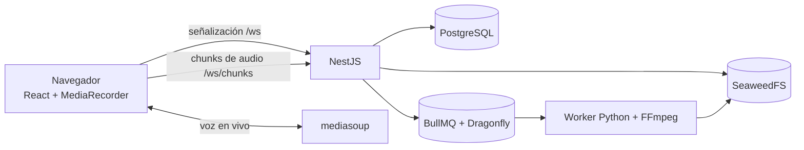

# PodSync

**Grabación remota de podcasts con una pista de audio independiente por participante.**

PodSync es una plataforma web donde los participantes de un podcast se reúnen en una sala virtual, conversan en tiempo real y, al mismo tiempo, cada uno graba su propio micrófono en su dispositivo. Al terminar se obtiene una pista limpia por persona, alineada con las demás, más una mezcla final lista para editar.

> **Estado:** en diseño. Todavía no hay código funcional. El desarrollo empieza por la Fase 0 (spikes de validación). Ver [Roadmap](#roadmap).

---

## El problema

Grabar un podcast remoto con Discord + OBS produce una sola pista con todas las voces mezcladas:

- no se puede ajustar el volumen de cada persona por separado;
- cuando dos personas hablan a la vez, la voz más baja se pierde;
- los cortes de red quedan grabados como cortes y artefactos en el audio;
- la edición exige técnicas avanzadas que no siempre funcionan.

## Cómo lo resuelve PodSync

| Qué | Cómo |
| --- | --- |
| **Calidad independiente de la red** | Cada navegador graba localmente su micrófono. La conexión en vivo solo se usa para conversar. |
| **Una pista por persona** | Cada participante genera su propia pista, alineada con las demás sobre un reloj común del servidor. |
| **Sin pérdida de audio** | El audio se envía en fragmentos de 5 segundos. Cada fragmento se guarda en el navegador hasta que el servidor confirma que lo recibió, así sobrevive a cortes de red y recargas de página. |
| **Varias tomas por sala** | Una sala admite varias sesiones de grabación seguidas, sin reinvitar a nadie. |
| **Invitados sin registro** | El anfitrión tiene cuenta; los invitados entran con un enlace y su nombre. |

## Funcionalidades principales

- Salas de hasta 5 participantes con voz en tiempo real (SFU).
- Grabación local por participante y envío en segundo plano.
- Control del anfitrión: iniciar y detener la grabación con cuenta regresiva.
- Reconexión automática, con silencio en la pista de quien se ausentó.
- Pistas individuales + mezcla final (FLAC por defecto), descargables por el anfitrión.

Más adelante: detección de voz con avatares animados, marcas de tiempo, reducción de ruido, notificaciones por email y soporte para Safari. Lista completa en el [TDD §3.1](docs/podsync-tdd.md#31-requerimientos-funcionales).

## Arquitectura

| Capa | Tecnología |
| --- | --- |
| Frontend | React 19, TypeScript, Vite, Tailwind CSS, shadcn/ui |
| API y WebSocket | NestJS (Fastify), Passport.js + argon2 |
| Voz en vivo | mediasoup (SFU) |
| Procesamiento de audio | Python + FFmpeg |
| Datos | PostgreSQL + Prisma, SeaweedFS (S3), BullMQ + Dragonfly |
| Infraestructura | Docker Compose, Caddy, GitHub Actions |
| Monorepo y releases | Turborepo + pnpm, release-please |

Detalle completo en el [TDD §5](docs/podsync-tdd.md#5-arquitectura-del-sistema).

## Navegadores soportados

| Navegador | Soporte |
| --- | --- |
| Chrome, Edge, Firefox (escritorio) | Desde el MVP |
| Safari | Desde el Hito 6 |

## Roadmap

| Fase | Contenido | Estado |
| --- | --- | --- |
| F0 | Spikes: grabación, reconstrucción y red de mediasoup | Pendiente |
| H1 | Monorepo, autenticación, salas y voz en tiempo real | Pendiente |
| **H2** | **Grabación, procesamiento y descarga — MVP** | Pendiente |
| H3 | Resiliencia, reconexiones y TTL de sala | Pendiente |
| H4 | Interacción en sala, detección de voz y avatares | Pendiente |
| H5 | Procesamiento avanzado y notificaciones | Pendiente |
| H6 | Reducción de ruido en cliente, Safari y optimización | Pendiente |
| H7 | Endurecimiento y lanzamiento público | Pendiente |

Plan detallado y estimaciones en el [TDD §11](docs/podsync-tdd.md#11-plan-de-desarrollo-por-hitos).

## Documentación

| Documento | Para qué |
| --- | --- |
| [`docs/podsync-tdd.md`](docs/podsync-tdd.md) | Diseño técnico completo: fuente de verdad del proyecto |
| [`openspec/constitution.md`](openspec/constitution.md) | Reglas no negociables del proyecto |
| [`AGENTS.md`](AGENTS.md) | Guía operativa para contribuir (personas y agentes de IA) |
| `docs/adr/` | Registro de decisiones de arquitectura |

## Contribuir

El proyecto usa flujo trunk-based con ramas cortas desde `main`, PRs con squash y títulos en Conventional Commits. Las versiones las gestiona release-please, una por paquete. Lee [`AGENTS.md`](AGENTS.md) antes de abrir un PR.

## Licencia

Pendiente de definir.
