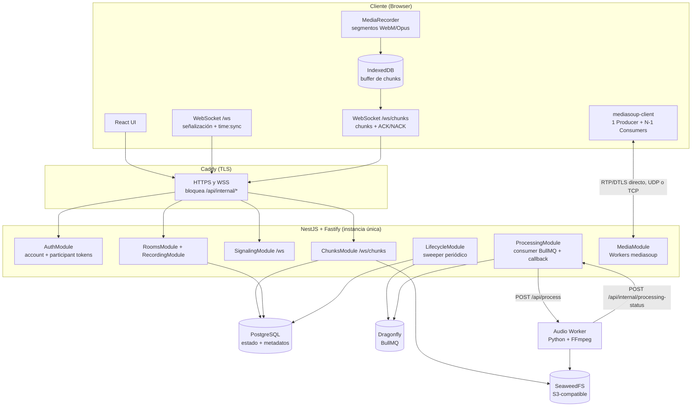

# PodSync — Documento Técnico de Diseño

**Plataforma de Grabación Remota para Podcasts**
**Versión 1.7.1 — Octubre 2026**

---

## Índice de Contenido

1. [Resumen Ejecutivo](#1-resumen-ejecutivo)
2. [Problemática Actual](#2-problemática-actual)
3. [Análisis de Requerimientos](#3-análisis-de-requerimientos)
4. [Selección del Stack Tecnológico](#4-selección-del-stack-tecnológico)
5. [Arquitectura del Sistema](#5-arquitectura-del-sistema)
6. [Diseño Detallado de Componentes](#6-diseño-detallado-de-componentes)
7. [Flujo de Identidad y Autenticación](#7-flujo-de-identidad-y-autenticación)
8. [Consideraciones de Seguridad](#8-consideraciones-de-seguridad)
9. [Estrategia de Testing](#9-estrategia-de-testing)
10. [Observabilidad y Monitorización](#10-observabilidad-y-monitorización)
11. [Plan de Desarrollo por Hitos](#11-plan-de-desarrollo-por-hitos)
12. [Matriz de Trazabilidad: Requerimientos vs Hitos](#12-matriz-de-trazabilidad-requerimientos-vs-hitos)
13. [Iteraciones Futuras (Post-Lanzamiento)](#13-iteraciones-futuras-post-lanzamiento)
14. [Resumen del Timeline](#14-resumen-del-timeline)
15. [Estimación de Costos de Infraestructura](#15-estimación-de-costos-de-infraestructura)
16. [Conclusiones](#16-conclusiones)
17. [Decisiones Abiertas y Limitaciones Conocidas](#17-decisiones-abiertas-y-limitaciones-conocidas)

---

## Changelog v1.7 → v1.7.1

| ID   | Cambio                                                                                                                                                         | Secciones afectadas  |
| ---- | -------------------------------------------------------------------------------------------------------------------------------------------------------------- | -------------------- |
| C-26 | Flujo trunk-based (solo `main`) y versionado semver por paquete con release-please (tags `<paquete>-v<versión>`). Los deploys salen de tags. Ver `openspec/constitution.md` §4 | §4.2, §11.1, §11.7 |

## Changelog v1.6 → v1.7

Origen común: revisión arquitectónica de v1.6 previa al inicio del desarrollo (octubre 2026). El detalle antes/después de cada cambio está en `PodSync_Diff_TDD_v1_6_a_v1_7.md`.

| ID   | Cambio                                                                                                                                                                                                           | Secciones afectadas                           |
| ---- | ---------------------------------------------------------------------------------------------------------------------------------------------------------------------------------------------------------------- | --------------------------------------------- |
| C-01 | Modelo de segmentos de grabación (una instancia de MediaRecorder = un segmento). Tabla `recording_segments`, `audio_chunks.segment_index`, nueva estructura de claves y reconstrucción por segmento en el worker | §5.3, §6.1.2, §6.2.3, §6.3, §6.4.1, §6.6      |
| C-02 | Protocolo binario v2: header de 44 bytes con `version`, `flags` y `segment_index`                                                                                                                                | §6.1.2                                        |
| C-03 | Sincronización de reloj (`time:sync`) y alineación de pistas sobre T0 del servidor. Deriva no corregida en el MVP                                                                                                | §3.2, §5.3, §6.1.4, §6.2.2, §6.3, §6.7.3, §17 |
| C-04 | Buffer de chunks persistente en IndexedDB, sin descarte silencioso                                                                                                                                               | §6.1.2, §6.4.1, §9.2                          |
| C-05 | Control de flujo con ventana de envío + token bucket + `chunk:nack`. La tasa ya no desconecta                                                                                                                    | §6.1.2, §6.2.2, §6.2.4                        |
| C-06 | Canal WebSocket dedicado para chunks (`/ws/chunks`)                                                                                                                                                              | §4.2, §5.1, §5.2, §6.2.2, §6.2.4              |
| C-07 | Validación de identidad del header contra el token del socket                                                                                                                                                    | §6.1.2, §6.2.4, §8                            |
| C-08 | Modelo de tokens: account token y participant token (host y guest). Nuevo `POST /api/rooms/:id/participant-token`                                                                                                | §6.2.1, §7                                    |
| C-09 | `RoomAccessPolicy` + guards `AccountGuard`, `RoomOwnerGuard`, `RoomMemberGuard`, `RoomHostGuard`. Ownership siempre verificado                                                                                   | §7.6, §7.7, §7.9                              |
| C-10 | Sweeper de ciclo de vida reemplaza los delayed jobs. Se eliminan `ttl_job_id`, `limit_job_id` y el recovery tras restart                                                                                         | §5.3, §6.4, §6.6, §9.2, §10                   |
| C-11 | Sesión activa única garantizada por índice único parcial                                                                                                                                                         | §3.3, §6.6, §11.2                             |
| C-12 | Grace period en H2, con salida anticipada                                                                                                                                                                        | §5.3, §6.4.5, §11, §12                        |
| C-13 | Descarga para el host en H2 (nuevo RF-28)                                                                                                                                                                        | §3.1, §6.2.1, §11, §12                        |
| C-14 | Worker: token interno, `/api/internal/*` no expuesto, idempotencia y timeout de procesamiento                                                                                                                    | §6.3, §6.4.5, §8, §10                         |
| C-15 | mediasoup: router diferido, limpieza ante caída del Worker, red y despliegue mínimo en H2                                                                                                                        | §3.3, §5.1, §6.9, §11                         |
| C-16 | Configuración de Dragonfly para BullMQ y snapshots                                                                                                                                                               | §4.2, §11.1                                   |
| C-17 | Recorte del MVP: VAD → H4; TTL de sala → H3; registro público, lockout y rotación de refresh → H7; Safari → H6                                                                                                   | §3, §7, §8, §11, §12                          |
| C-18 | Fase 0 de spikes (SPIKE-01, SPIKE-02)                                                                                                                                                                            | §11.0, §14                                    |
| C-19 | Procesamiento de captura de audio como decisión pendiente (D-02)                                                                                                                                                 | §6.1.1, §17                                   |
| C-20 | Catálogo de eventos WebSocket alineado con el H1, con columnas Canal e Hito                                                                                                                                      | §6.2.2                                        |
| C-21 | Tabla `refresh_tokens` y endpoint `POST /api/auth/logout`                                                                                                                                                        | §6.2.1, §6.6, §7.2                            |
| C-22 | Nuevo RNF-08 (alineación entre pistas). RNF-05 acotado en el MVP                                                                                                                                                 | §3.2, §12.2                                   |
| C-23 | Nueva §17: decisiones abiertas y limitaciones conocidas                                                                                                                                                          | §17                                           |
| C-24 | Corrección del total del timeline                                                                                                                                                                                | §14                                           |
| C-25 | Diagrama de componentes en Mermaid                                                                                                                                                                               | §5.2                                          |

**Nota:** el TDD v1.7 es la única fuente de verdad del proyecto. Las decisiones pendientes de §17 deben cerrarse antes del hito que bloquean. `H1_Historias_de_Usuario.md` y `AGENTS.md` deben sincronizarse con esta versión.

### Changelog v1.5 → v1.6 (histórico)

| #   | Cambio                                                                                                                                                                                                 | Origen                                 | Secciones afectadas                   |
| --- | ------------------------------------------------------------------------------------------------------------------------------------------------------------------------------------------------------ | -------------------------------------- | ------------------------------------- |
| 1   | Múltiples sesiones de grabación por sala (secuenciales, no simultáneas). Estado `rooms.status` simplificado a `active / closed`                                                                        | ADR-001                                | §3.1, §5.3, §6.2.1, §6.2.2, §6.6, §11 |
| 2   | Límites de tiempo configurables: `max_room_duration_ms` y `max_recording_duration_ms` en `room_settings`, enforcement server-side con BullMQ delayed jobs _(reemplazado en v1.7 por el sweeper, C-10)_ | ADR-001                                | §3.1, §6.2.1, §6.2.2, §6.4, §6.6, §11 |
| 3   | Warnings de tiempo al cliente vía WebSocket (`room:time-warning`, `recording:time-warning`, `*:time-expired`)                                                                                          | ADR-001                                | §6.2.2, §11                           |
| 4   | Room TTL respeta grace period antes de cerrar la sala                                                                                                                                                  | ADR-001                                | §6.4                                  |
| 5   | Autenticación básica para hosts con Passport.js (email+password, argon2). Guests permanecen efímeros                                                                                                   | ADR-002 + decisión de diseño posterior | §3.3, §6.2.1, §6.6, §7, §8, §11       |
| 6   | Tabla `users` en el schema desde H1 con campos mínimos. `rooms.owner_user_id` con FK real a `users` (nullable para desarrollo local)                                                                   | ADR-002 (modificado)                   | §6.6                                  |
| 7   | Asimetría de identidad host/guest como principio de diseño explícito                                                                                                                                   | ADR-002                                | §7                                    |
| 8   | `participants.user_id` nullable como puente de vinculación retroactiva                                                                                                                                 | ADR-002                                | §6.6                                  |
| 9   | Guard de autorización del host encapsulado con lógica reemplazable _(evolucionado en v1.7 a `RoomAccessPolicy`, C-09)_                                                                                 | ADR-002                                | §7                                    |
| 10  | Endpoint `GET /api/rooms/:id/sessions` para listar sesiones de una sala                                                                                                                                | ADR-001                                | §6.2.1                                |
| 11  | Recovery de delayed jobs tras restart _(eliminado en v1.7, C-10)_                                                                                                                                      | ADR-001                                | §6.4, §9.2                            |
| 12  | Máximo global de duración como hard limit cuando no existe plan asociado al host                                                                                                                       | Decisión de diseño                     | §6.4, §8                              |

**Nota sobre ADRs anteriores:** los documentos ADR-001 (Múltiples Sesiones y Límites de Tiempo) y ADR-002 (Asimetría de Identidad Host/Guest) quedan como artefactos históricos del proceso de diseño. Sus decisiones están integradas en este TDD.

---

## 1. Resumen Ejecutivo

PodSync es una plataforma web diseñada para la grabación remota de podcasts con captura de audio individual por participante. A diferencia del flujo actual basado en Discord + OBS, donde el audio se mezcla en una sola pista, PodSync permite que cada participante grabe localmente en su dispositivo y envíe fragmentos al servidor en segundo plano. El resultado son pistas de audio independientes y de alta calidad que facilitan la edición y la post-producción.

La comunicación en vivo entre participantes se realiza mediante un servidor SFU (Selective Forwarding Unit) basado en mediasoup. Ofrece baja latencia y mejor escalabilidad que una topología peer-to-peer pura, y reduce la carga de CPU en los clientes.

La plataforma implementa un modelo de identidad asimétrico. Los hosts (creadores de sala) requieren una cuenta persistente con autenticación por email y contraseña. Los guests (invitados) participan de forma efímera mediante un enlace de invitación, sin registro. Dentro de una sala, hosts y guests usan el mismo tipo de credencial: un token de participante con alcance de sala. Este diseño protege los recursos del servidor y sienta la base para un modelo comercial futuro con planes y límites de uso.

Las salas soportan múltiples sesiones de grabación secuenciales, lo que permite grabar varios episodios o repetir tomas sin recrear la sala ni reinvitar participantes. Cada sesión de grabación y cada sala tienen límites de tiempo configurables. Su enforcement se realiza exclusivamente en el servidor, mediante un proceso periódico de ciclo de vida que usa PostgreSQL como fuente del estado.

Las pistas de cada participante se alinean sobre un instante de referencia (T0) definido por el reloj del servidor. Cada instancia de grabación del navegador se modela como un segmento independiente, lo que permite reconstruir pistas completas incluso tras recargas de página o pérdidas parciales de datos.

Este documento detalla la arquitectura, el stack tecnológico, los flujos de datos, el modelo de autenticación, la estrategia de testing y el plan de desarrollo incremental, organizado en hitos, para llevar el producto desde su MVP hasta una solución completa.

---

## 2. Problemática Actual

### 2.1 Descripción del Problema

El flujo actual de grabación presenta las siguientes deficiencias:

- **Audio mezclado en una sola pista:** OBS captura la salida de audio de Discord como un único stream, mezclando todas las voces. Esto imposibilita la normalización individual del volumen.
- **Pérdida de diálogos:** cuando dos o más personas hablan simultáneamente, las voces con menor volumen se pierden al estar mezcladas.
- **Inestabilidad de conexión:** las fluctuaciones de red de los participantes afectan la calidad del audio grabado, generando cortes y artefactos en la pista final.
- **Edición compleja:** sin pistas separadas, la post-producción requiere técnicas avanzadas (noise gates, compresores laterales) que no siempre logran resultados óptimos.

### 2.2 Solución Propuesta

Desarrollar una aplicación web donde los participantes se reúnan en una sala virtual y se comuniquen en tiempo real mediante un SFU (mediasoup). En paralelo, cada cliente graba su propio audio localmente usando la MediaRecorder API del navegador. Estos fragmentos de audio se envían de forma incremental al servidor vía WebSocket, que los almacena en un servicio compatible con S3 (SeaweedFS). Al finalizar cada sesión de grabación se procesan las pistas individuales y se genera también una mezcla consolidada. Una sala puede albergar múltiples sesiones de grabación secuenciales.

---

## 3. Análisis de Requerimientos

### 3.1 Requerimientos Funcionales

| ID    | Requerimiento                                                                                     | Prioridad |
| ----- | ------------------------------------------------------------------------------------------------- | --------- |
| RF-01 | Crear sala de podcast con código/enlace de invitación (requiere host autenticado)                 | Alta      |
| RF-02 | Comunicación de voz en tiempo real entre participantes (hasta 5)                                  | Alta      |
| RF-03 | Grabación local de audio individual en cada dispositivo                                           | Alta      |
| RF-04 | Envío de fragmentos de audio (chunks) al servidor en segundo plano                                | Alta      |
| RF-05 | Almacenamiento de chunks en servicio compatible con S3                                            | Alta      |
| RF-06 | Control del anfitrión: iniciar/finalizar grabación con cuenta regresiva                           | Alta      |
| RF-07 | Prueba de sonido individual antes de iniciar grabación (escuchar/descargar)                       | Alta      |
| RF-08 | Botón de muteo/desmuteo de micrófono                                                              | Alta      |
| RF-09 | Botón de levantar la mano (aviso visual a todos)                                                  | Media     |
| RF-10 | Botón de marca de tiempo (timestamp bookmark)                                                     | Media     |
| RF-11 | Botón de sugerencia de finalización de sesión                                                     | Media     |
| RF-12 | Reconexión automática con generación de silencio en pista del ausente                             | Alta      |
| RF-13 | Generación de pista final con mezcla de todos los participantes                                   | Alta      |
| RF-14 | Notificación a posteriori con enlace de descarga cuando audios estén listos                       | Media     |
| RF-15 | Periodo de gracia post-sesión para recibir chunks pendientes                                      | Alta      |
| RF-16 | Reducción de ruido opcional en el audio capturado                                                 | Baja      |
| RF-17 | Detección de actividad de voz (VAD) con indicador visual por participante                         | Media     |
| RF-18 | Avatares animados: subir imagen idle/hablando con alternancia por VAD                             | Media     |
| RF-19 | Registro de eventos VAD (timestamps inicio/fin de voz) para post-producción                       | Media     |
| RF-20 | Registro público de usuario host con email y contraseña (en el MVP las cuentas se crean por seed) | Alta      |
| RF-21 | Inicio de sesión (login) para hosts                                                               | Alta      |
| RF-22 | Múltiples sesiones de grabación secuenciales por sala (no simultáneas)                            | Alta      |
| RF-23 | Límite de tiempo configurable por sesión de grabación con enforcement server-side                 | Alta      |
| RF-24 | Límite de tiempo configurable por sala (TTL) con enforcement server-side                          | Alta      |
| RF-25 | Warnings de tiempo al cliente cuando se acercan los límites                                       | Media     |
| RF-26 | Listado de sesiones de grabación por sala                                                         | Media     |
| RF-27 | Cierre automático de sala por expiración de TTL respetando grace period                           | Alta      |
| RF-28 | Descarga de pistas procesadas y mezcla (host en el MVP; guests en H5)                             | Alta      |

### 3.2 Requerimientos No Funcionales

| ID     | Requerimiento                           | Métrica                                                                                                                        |
| ------ | --------------------------------------- | ------------------------------------------------------------------------------------------------------------------------------ |
| RNF-01 | Bajo consumo de recursos en el cliente  | < 10% CPU, < 150 MB RAM                                                                                                        |
| RNF-02 | Latencia de comunicación en tiempo real | < 300 ms (audio conversacional)                                                                                                |
| RNF-03 | Tolerancia a pérdida de paquetes        | Recuperación sin pérdida de grabación                                                                                          |
| RNF-04 | Disponibilidad del servicio             | > 99.5% uptime                                                                                                                 |
| RNF-05 | Compatibilidad de navegadores           | MVP: Chrome, Edge, Firefox (escritorio). Safari desde H6                                                                       |
| RNF-06 | Tiempo de procesamiento post-sesión     | < 2x la duración del episodio                                                                                                  |
| RNF-07 | Escalabilidad                           | Múltiples salas concurrentes                                                                                                   |
| RNF-08 | Alineación temporal entre pistas        | Desfase inicial entre pistas ≤ 30 ms (propuesta, se confirma en SPIKE-01, D-05). Deriva de reloj no corregida en el MVP (D-04) |

### 3.3 Restricciones

- Máximo 5 participantes por sala.
- Plataforma web (navegador) como target principal. En el MVP: Chrome, Edge y Firefox de escritorio. Safari se incorpora en H6.
- Los hosts requieren cuenta persistente (email + contraseña) para crear salas. En el MVP las cuentas se crean mediante seed (`pnpm seed:user`); el registro público se habilita en H7. Los guests participan de forma efímera mediante enlace de invitación, sin registro.
- Solo puede existir una sesión de grabación activa por sala en un momento dado. El host no puede iniciar una nueva grabación mientras haya una sesión en estado `recording` o `grace_period`. Esta regla la garantiza un índice único parcial en PostgreSQL (§6.6).
- Los límites de tiempo de sala y grabación se aplican mediante hard limits globales configurables por variable de entorno cuando no existe un plan asociado al host (valores en §17, D-01). En el futuro, estos hard limits se reemplazan por los topes del plan comercial del usuario.
- El audio procesado no estará disponible para descarga inmediata.
- En el MVP el backend corre como una única instancia de NestJS. El estado de mediasoup y de las conexiones WebSocket vive en memoria (§6.9). El estado de salas y sesiones vive en PostgreSQL.

---

## 4. Selección del Stack Tecnológico

### 4.1 Análisis Comparativo

Se analizaron las opciones vigentes para cada componente del sistema, priorizando eficiencia, ecosistema y bajo consumo de recursos.

#### 4.1.1 Frontend

| Opción             | Ventajas                                                                  | Desventajas                                     | Veredicto          |
| ------------------ | ------------------------------------------------------------------------- | ----------------------------------------------- | ------------------ |
| React + TypeScript | Ecosistema maduro, amplia comunidad, excelente soporte para Web Audio API | Bundle size mayor que alternativas más ligeras  | **SELECCIONADO**   |
| SvelteKit          | Bundle más pequeño, reactivo por defecto                                  | Ecosistema más pequeño para integraciones media | Alternativa viable |
| Vue 3              | API de composición moderna, buen rendimiento                              | Menos librerías específicas para audio          | Descartado         |

#### 4.1.2 Backend

| Opción                   | Ventajas                                                                                                 | Desventajas                                                        | Veredicto                                                |
| ------------------------ | -------------------------------------------------------------------------------------------------------- | ------------------------------------------------------------------ | -------------------------------------------------------- |
| NestJS (Fastify adapter) | Arquitectura modular, inyección de dependencias, WebSocket Gateways nativos, mismo lenguaje que frontend | Mayor consumo de memoria base (~30-60 MB extra vs Fastify puro)    | **SELECCIONADO**                                         |
| Node.js (Fastify puro)   | Mínimo overhead, alto throughput, bajo consumo de memoria                                                | Sin estructura opinada, requiere más código de organización manual | Evaluado, descartado por menor mantenibilidad            |
| Go                       | Alto rendimiento, concurrencia nativa con goroutines, bajo consumo de memoria                            | Lenguaje diferente al frontend, curva de aprendizaje               | Alternativa para escalar servicios auxiliares            |
| Python (FastAPI)         | Excelente para procesamiento de audio (scipy, librosa)                                                   | Mayor consumo de memoria, GIL limita concurrencia                  | **SELECCIONADO para servicio de procesamiento de audio** |

#### 4.1.3 Comunicación en Tiempo Real

| Opción                     | Ventajas                                                                                                                                                                 | Desventajas                                                                                                                                                                        | Veredicto                                                           |
| -------------------------- | ------------------------------------------------------------------------------------------------------------------------------------------------------------------------ | ---------------------------------------------------------------------------------------------------------------------------------------------------------------------------------- | ------------------------------------------------------------------- |
| WebRTC (peer-to-peer mesh) | Baja latencia, sin pasar por servidor, cifrado E2E                                                                                                                       | Con N participantes, cada cliente mantiene N-1 conexiones. A 5 peers: 4 encoders + 4 decoders por cliente, carga de CPU excesiva en hardware modesto. Complejidad de NAT traversal | Descartado por problemas de escalabilidad en mesh ≥ 4 participantes |
| **mediasoup (SFU)**        | Cada cliente envía 1 stream al servidor y recibe N-1. Reduce carga CPU del cliente ~75% vs mesh. Control centralizado de calidad. Arquitectura extensible a video futuro | Requiere servidor dedicado con mayor ancho de banda de salida                                                                                                                      | **SELECCIONADO**                                                    |
| LiveKit                    | SFU open-source completo, SDKs multiplataforma                                                                                                                           | Mayor complejidad operacional, opinionated                                                                                                                                         | Evaluado para iteraciones futuras                                   |

**Justificación del cambio de P2P a SFU:** en una topología full mesh con 5 participantes, cada cliente debe mantener 4 conexiones RTCPeerConnection simultáneas, codificando y decodificando 4 streams de audio. Combinado con MediaRecorder, VAD y potencial RNNoise WASM, el cumplimiento de RNF-01 (< 10% CPU, < 150 MB RAM) no es viable en hardware de consumo. mediasoup reduce la carga del cliente a 1 uplink + N-1 downlinks sin re-encoding, y centraliza el control de calidad y la gestión de conexiones.

#### 4.1.4 Almacenamiento

| Opción                      | Ventajas                                                                                                                                       | Desventajas                                                                                 | Veredicto                                   |
| --------------------------- | ---------------------------------------------------------------------------------------------------------------------------------------------- | ------------------------------------------------------------------------------------------- | ------------------------------------------- |
| **SeaweedFS (self-hosted)** | Compatible con S3 API, licencia Apache 2.0, ligero, bajo consumo, misma instancia en dev y prod elimina bugs por divergencia de comportamiento | Comunidad más pequeña, menos documentación empresarial, responsabilidad operacional propia  | **SELECCIONADO (dev y producción)**         |
| AWS S3                      | Alta disponibilidad, escalabilidad automática                                                                                                  | Costos variables, diferencias sutiles con SeaweedFS en multipart upload y consistency model | Descartado para evitar divergencia dev/prod |
| Cloudflare R2               | Compatible S3, sin costos de egress                                                                                                            | Menor ecosistema de herramientas                                                            | Alternativa futura si se necesita CDN       |

**Nota:** para mitigar el riesgo de lock-in y facilitar una migración futura, toda la interacción con almacenamiento de objetos se realiza a través de una interfaz de abstracción (`StoragePort`) en el backend. Esto permite cambiar el proveedor sin modificar la lógica de negocio.

#### 4.1.5 Autenticación

| Opción                             | Ventajas                                                                                                                              | Desventajas                                                                                              | Veredicto                                                                                                      |
| ---------------------------------- | ------------------------------------------------------------------------------------------------------------------------------------- | -------------------------------------------------------------------------------------------------------- | -------------------------------------------------------------------------------------------------------------- |
| **Passport.js (@nestjs/passport)** | Integración nativa con NestJS, estrategias modulares (Local, JWT, OAuth futuro), zero overhead operacional, sin servicios adicionales | Requiere implementar manualmente reset de password, verificación de email                                | **SELECCIONADO**                                                                                               |
| Keycloak                           | SSO completo, OAuth2/OIDC, UI de administración, MFA, federation LDAP/SAML                                                            | 500 MB-1 GB RAM, requiere DB dedicada, complejidad operacional alta, sobredimensionado para etapa actual | Descartado para MVP. Reevaluar si se necesita SSO empresarial o federation con identity providers corporativos |
| Casdoor                            | Similar a Keycloak pero más ligero (Go), UI moderna                                                                                   | 200-400 MB RAM, servicio adicional en Docker Compose, documentación irregular, comunidad más pequeña     | Descartado para MVP por mismas razones que Keycloak en menor medida                                            |

**Justificación de Passport sobre identity providers externos:** el requisito actual es un "candado en la puerta": autenticación básica para hosts que proteja los recursos del servidor. Passport lo resuelve con ~3-5 días de implementación, 0 MB de RAM adicional y 0 servicios extra en Docker Compose. Keycloak o Casdoor resuelven problemas que PodSync no tiene todavía (SSO multi-aplicación, federation corporativa, MFA). La migración futura de Passport a un provider externo es limpia si el `AuthModule` usa el patrón Strategy, que es exactamente cómo funciona Passport.

### 4.2 Stack Seleccionado (Resumen)

| Componente              | Tecnología                                                 | Justificación                                                                               |
| ----------------------- | ---------------------------------------------------------- | ------------------------------------------------------------------------------------------- |
| Frontend                | React 19 + TypeScript + Vite                               | Madurez del ecosistema, excelente soporte Web APIs                                          |
| UI Framework            | Tailwind CSS + shadcn/ui                                   | Desarrollo rápido, consistencia visual, bajo overhead                                       |
| Buffer local de chunks  | IndexedDB (API nativa del navegador)                       | Persistencia de chunks no confirmados ante refresh o cierre de pestaña (§6.1.2)             |
| Backend (API/WebSocket) | NestJS + Fastify adapter + @nestjs/websockets              | Arquitectura modular, DI, WebSocket Gateways, mismo lenguaje                                |
| Backend (Procesamiento) | Python + FFmpeg                                            | Ecosistema líder en procesamiento de audio                                                  |
| Autenticación           | Passport.js (@nestjs/passport) + argon2                    | Integración nativa NestJS, zero overhead, estrategias modulares                             |
| Comunicación en vivo    | mediasoup (SFU)                                            | Baja carga en clientes, escalable a 5+ participantes, control centralizado                  |
| Señalización            | NestJS WebSocket Gateway (ws) en `/ws`                     | Integrado con el framework, decoradores tipados                                             |
| Transporte de chunks    | Endpoint WebSocket dedicado `/ws/chunks` (frames binarios) | Aísla el tráfico binario y su control de flujo de la señalización JSON (§6.2.2)             |
| Almacenamiento objetos  | SeaweedFS (dev y producción)                               | API S3-compatible, Apache 2.0, paridad dev/prod                                             |
| Abstracción storage     | `StoragePort` interface (NestJS)                           | Desacopla lógica de negocio del proveedor S3                                                |
| Base de datos           | PostgreSQL + Prisma ORM                                    | Robusto, relacional, excelente con Node.js. Fuente de verdad del estado de salas y sesiones |
| Cola de tareas          | BullMQ + Dragonfly                                         | Ejecución asíncrona de jobs (procesamiento, sweeper). El estado no vive en la cola          |
| Bridge Cola→Worker      | HTTP (NestJS consumer → Python REST)                       | Desacoplamiento total entre servicios (ver §6.3)                                            |
| Procesamiento audio     | FFmpeg + RNNoise (WASM)                                    | Estándar de la industria + reducción de ruido eficiente                                     |
| Reverse Proxy / SSL     | Caddy                                                      | SSL automático con Let's Encrypt, config mínima. Solo HTTP/WSS (§6.9)                       |
| Monorepo                | Turborepo + pnpm + Corepack                                | Cache inteligente de builds, task pipeline, eficiente en disco                              |
| Contenerización         | Docker + Docker Compose                                    | Entorno reproducible, fácil despliegue                                                      |
| CI/CD                   | GitHub Actions                                             | Integración nativa con repositorios                                                         |
| Versionado y releases   | release-please (modo manifest, una versión por paquete)    | Semver y CHANGELOG automáticos desde Conventional Commits; flujo trunk-based                |
| Logging                 | pino (NestJS)                                              | Structured logging, alto rendimiento, JSON nativo                                           |

**Nota sobre Dragonfly + BullMQ:** Dragonfly requiere configuración específica para funcionar con BullMQ. Según su documentación, eso implica modo cluster emulado, bloqueo por hashtags y un prefijo de cola con hashtag (p. ej. `{podsync}`). También deben habilitarse snapshots para persistencia. Los flags concretos son referenciales: se verifican contra la documentación vigente y se fijan en la tarea de infraestructura (US-002). Como el estado de salas y sesiones vive en PostgreSQL (§6.4.5), una pérdida de datos en Dragonfly no deja salas ni sesiones en estado inconsistente.

---

## 5. Arquitectura del Sistema

### 5.1 Visión General

La arquitectura se organiza en capas separadas siguiendo un patrón de microservicios ligeros, donde cada componente tiene una responsabilidad bien definida:

1. **Capa de Cliente (Browser):** captura de audio local, grabación con MediaRecorder en segmentos, buffer persistente de chunks en IndexedDB, envío de chunks por `/ws/chunks`, sincronización de reloj y conexión al SFU para comunicación en vivo.
2. **Capa de Señalización y API (NestJS):** gestión de salas, autenticación (account tokens para hosts, participant tokens para todos dentro de la sala), WebSocket Gateway de señalización (`/ws`), recepción de chunks (`/ws/chunks`), integración con mediasoup y proceso de ciclo de vida. Organizado en módulos: `AuthModule`, `UsersModule`, `RoomsModule`, `RecordingModule`, `SignalingModule`, `ChunksModule`, `MediaModule`, `StorageModule`, `ProcessingModule`, `LifecycleModule`.
3. **Capa de Media (mediasoup):** SFU que recibe el audio de cada participante y lo distribuye selectivamente a los demás. Los Workers de mediasoup son subprocesos nativos (C++) gestionados desde NestJS en la misma máquina mediante la API Node.js de mediasoup. Routers, transports, producers y consumers viven en memoria de la instancia (§6.9).
4. **Capa de Almacenamiento:** SeaweedFS (S3-compatible) para chunks de audio y archivos procesados. PostgreSQL para metadatos, cuentas de usuario y estado de salas y sesiones.
5. **Capa de Procesamiento (Worker Python):** reconstrucción de pistas por segmento, alineación, generación de silencio, reducción de ruido, mezcla final. Se comunica con NestJS vía HTTP autenticado con token interno.
6. **Capa de Notificación:** aviso por email/webhook cuando los audios están listos para descarga (H5).

### 5.2 Diagrama de Componentes



### 5.3 Flujo de Datos Principal

**Fase 1 — Pre-sesión:** el host inicia sesión con su cuenta (ver §7) y crea una sala. Recibe `room_id`, el código de invitación y un participant token con `role: host`. Los guests se unen con su nombre y, opcionalmente, un email a través del enlace de invitación. Reciben un participant token con `role: guest`. Todos se conectan a `/ws` (señalización), a `/ws/chunks` (envío de audio) y al SFU (mediasoup), y realizan una primera sincronización de reloj (`time:sync`, §6.1.4). Hacen pruebas de sonido.

**Fase 2 — Inicio de grabación:** el host presiona iniciar grabación. El servidor intenta crear una nueva `recording_session`. El índice único parcial rechaza el intento con 409 si ya existe una sesión en `recording` o `grace_period`. Desde H3 también se valida que el TTL restante de la sala sea mayor a 5 minutos. El servidor define T0 = ahora + duración del countdown, guarda `started_at = T0` y emite `recording:countdown` con T0. Durante el countdown, cada cliente repite `time:sync` y agenda el inicio de su MediaRecorder para T0 según su reloj corregido. No se programa ningún job por sesión: el límite de grabación lo aplica el sweeper (§6.4.5).

**Fase 3 — Grabación activa:** cada cliente abre un segmento (`segment:start`, con su `start_offset_ms` medido respecto de T0) y genera chunks cada 5 segundos (configurable). Cada chunk se escribe primero en IndexedDB y luego se envía por `/ws/chunks` como frame binario, respetando la ventana de envío y el token bucket (§6.1.2, §6.2.4). El servidor valida el header contra la identidad del socket, sube el chunk a SeaweedFS, registra los metadatos en PostgreSQL y responde ACK. El cliente borra de IndexedDB solo los chunks confirmados.

**Fase 4 — Finalización:** el host presiona finalizar, o el sweeper fuerza el stop porque se alcanzó el límite de grabación. Se emite el countdown de cierre. Al llegar a cero, cada cliente detiene su MediaRecorder y envía su último chunk con el flag `FINAL`. La sesión pasa a `grace_period` con `grace_until = ended_at + grace_period_ms` (5 minutos por defecto). Si todos los participantes que estaban conectados al momento del stop entregaron su chunk `FINAL`, la sesión pasa a `processing` de inmediato. Si no, el sweeper la transiciona al vencer `grace_until`. La sala permanece activa y el host puede iniciar una nueva sesión.

**Fase 5 — Procesamiento:** al pasar a `processing`, NestJS encola un job en BullMQ. Un consumer interno toma el job y envía una petición HTTP autenticada al worker Python. El worker reconstruye cada segmento, lo posiciona en la línea de tiempo según su `start_offset_ms`, rellena con silencio los huecos, aplica reducción de ruido opcional (H5) y produce la pista individual de cada participante y la mezcla final en el formato configurado (FLAC por defecto). Si el worker no reporta resultado dentro del timeout, el sweeper marca la sesión como `failed`.

**Fase 6 — Entrega y notificación:** en el MVP, el host obtiene las pistas desde `GET /api/sessions/:id/download` (presigned URLs de 72 horas). Desde H5 se notifica por email a los participantes que dieron su email, con el enlace de descarga. Si varias sesiones de la misma sala terminan en un rango corto (< 5 minutos), las notificaciones se agrupan en un solo email. También se soporta webhook como canal de notificación.

**Fase 7 — Cierre de sala:** el host cierra la sala manualmente (H2), o la sala expira por TTL (H3). Si el TTL expira durante una grabación activa, el sistema fuerza el stop con el flujo normal (countdown → stop → grace period → processing) y luego cierra la sala. Las pistas procesadas siguen disponibles para descarga hasta que expire la retención.

---

## 6. Diseño Detallado de Componentes

### 6.1 Cliente (Frontend)

#### 6.1.1 Captura de Audio Local

Se utiliza `navigator.mediaDevices.getUserMedia()` para obtener el audio del micrófono. Ese audio alimenta dos flujos paralelos:

- **mediasoup (SFU):** el track se conecta a un Transport de `mediasoup-client` que envía el audio al servidor SFU. El SFU lo distribuye a los demás participantes. Cada cliente mantiene un único Producer (uplink) y N-1 Consumers (downlinks).
- **MediaRecorder:** el audio se graba localmente con codec Opus en contenedor WebM (`audio/webm;codecs=opus`). Se configura con `timeslice` de 5000 ms para generar chunks periódicos y con `audioBitsPerSecond: 128000` (configurable; ~58 MB por hora). Antes de habilitar la grabación, el cliente verifica `MediaRecorder.isTypeSupported('audio/webm;codecs=opus')`. Si el navegador no lo soporta, se muestra un mensaje explícito y el participante no puede unirse a grabaciones.

Esta arquitectura dual hace que la grabación sea independiente de la calidad de la conexión. Aunque el SFU sufra degradación, la grabación local mantiene la calidad original del micrófono.

**Procesamiento de captura (decisión pendiente D-02, §17):** por defecto, `getUserMedia` aplica `echoCancellation`, `noiseSuppression` y `autoGainControl`. Estos filtros son deseables en la llamada en vivo, pero degradan el audio grabado. Las opciones son:

| Opción                      | Descripción                                                                                                                          | Pros                                                | Contras                                                                                                     |
| --------------------------- | ------------------------------------------------------------------------------------------------------------------------------------ | --------------------------------------------------- | ----------------------------------------------------------------------------------------------------------- |
| A — Doble captura           | Dos `getUserMedia` del mismo dispositivo: uno con los tres filtros desactivados (MediaRecorder) y otro con los filtros activos (SFU) | Grabación cruda de máxima calidad y llamada sin eco | Debe validarse que Chrome, Edge y Firefox entreguen ambas capturas con constraints distintas. Mayor consumo |
| B — Captura única procesada | Un solo track con filtros activos para ambos flujos. Se recomienda el uso de audífonos                                               | Simple, sin riesgo de compatibilidad                | La grabación hereda los artefactos de los filtros del navegador                                             |

La opción se decide con la evidencia de SPIKE-01 (§11.0). Si A es viable, es la opción preferida.

#### 6.1.2 Segmentos, Buffer y Envío de Chunks

**Segmentos de grabación.** Un _segmento_ corresponde a una instancia de MediaRecorder. Solo el primer chunk de un segmento contiene el header WebM (EBML + Segment Info + Tracks). Los demás chunks son continuación del mismo stream de bytes y **no son decodificables por separado**. Una sesión de grabación normal tiene un único segmento por participante (`segment_index = 0`). Se abre un segmento nuevo (`segment_index + 1`) cada vez que el cliente debe crear un MediaRecorder nuevo durante la misma sesión, por ejemplo tras recargar la página (H3).

Al abrir un segmento, el cliente envía por `/ws/chunks` un mensaje de control `segment:start` con:

- `session_id`, `segment_index`;
- `start_offset_ms`: inicio real del segmento respecto de T0, en reloj del servidor (§6.1.4);
- `clock_offset_ms` y `rtt_ms` de la última sincronización (diagnóstico);
- `mime_type` efectivo del MediaRecorder.

El servidor registra el segmento en `recording_segments` y responde `segment:ack`. Solo después el cliente envía chunks de ese segmento.

**Buffer persistente.** Cada chunk generado se escribe primero en IndexedDB, con clave `(session_id, participant_id, sequence_number)`, y luego entra a la cola de envío. Un chunk se borra de IndexedDB **solo cuando el servidor confirma su recepción con `chunk:ack`**. El cliente también persiste en IndexedDB el estado de la sesión en curso: `session_id`, `segment_index` actual, siguiente `sequence_number` y T0. Esto permite retomar tras una recarga (H3). Antes de iniciar la primera grabación, el cliente llama a `navigator.storage.persist()` y `navigator.storage.estimate()`. Si la cuota libre es menor a la necesaria para el límite de grabación vigente (bitrate × límite), muestra un aviso.

**Política ante cuota llena (propuesta, D-03, §17):** si una escritura en IndexedDB falla con `QuotaExceededError`:

1. el chunk queda en una cola en memoria y se sigue intentando enviar;
2. se muestra un banner al participante;
3. se emite `recording:local-buffer-warning`, que el servidor reenvía al host;
4. la grabación no se detiene.

**Nunca se descartan chunks sin confirmar.** El riesgo residual es perder lo que esté en la cola en memoria si además se cierra la pestaña.

**Protocolo binario v2.** Cada chunk se envía por `/ws/chunks` como un frame binario: un header de 44 bytes seguido del payload WebM/Opus.

| Campo             | Bytes | Tipo               | Descripción                                                                                                                                                               |
| ----------------- | ----- | ------------------ | ------------------------------------------------------------------------------------------------------------------------------------------------------------------------- |
| `version`         | 1     | uint8              | Versión del protocolo. Valor actual: `2`                                                                                                                                  |
| `flags`           | 1     | uint8              | bit 0 = `SEGMENT_START` (primer chunk del segmento, contiene el header WebM); bit 1 = `FINAL` (último chunk de la sesión para este participante); bits 2–7 reservados (0) |
| `segment_index`   | 2     | uint16, big-endian | Índice del segmento dentro de la sesión, por participante                                                                                                                 |
| `session_id`      | 16    | UUID binario       | Sesión de grabación                                                                                                                                                       |
| `participant_id`  | 16    | UUID binario       | Participante emisor. Debe coincidir con el `sub` del participant token del socket                                                                                         |
| `sequence_number` | 4     | uint32, big-endian | Monotónico por participante y sesión, continuo entre segmentos                                                                                                            |
| `timestamp_ms`    | 4     | uint32, big-endian | Inicio estimado del chunk respecto de T0, en reloj del servidor. Informativo, salvo en el primer chunk tras un hueco dentro de un segmento (§6.3)                         |

**Control de flujo y confirmación:**

- **Ventana de envío:** el cliente mantiene como máximo 4 chunks en vuelo sin respuesta. Solo envía un chunk nuevo cuando recibe un `chunk:ack` o un `chunk:nack`.
- **ACK:** el servidor responde `chunk:ack` con el `sequence_number` cuando el chunk quedó almacenado en SeaweedFS y registrado en PostgreSQL. La recepción es idempotente: un `sequence_number` ya almacenado recibe ACK de nuevo, sin volver a subirse.
- **NACK:** si el servidor no puede aceptar el chunk por tasa (§6.2.4), responde `chunk:nack` con `retry_after_ms`. El cliente reintenta después de ese tiempo; un NACK no cuenta como reintento fallido. Si el motivo es `session_closed` (el chunk llegó después del grace period), el cliente lo informa al usuario y lo descarta.
- **Timeout:** si no hay respuesta en 5 segundos, el chunk se reenvía con backoff exponencial (máximo 3 reintentos mientras la conexión siga abierta). Tras agotar los reintentos, el chunk permanece en IndexedDB y se reenvía en la siguiente conexión. Nunca se descarta.
- **Desconexión:** si `/ws/chunks` se cae, MediaRecorder sigue grabando y los chunks se acumulan en IndexedDB. Al reconectar, el cliente se autentica de nuevo y envía los pendientes en orden de `sequence_number`, respetando la ventana.

#### 6.1.3 Interfaz de Usuario

La interfaz se organiza en los siguientes elementos principales:

| Elemento                      | Descripción                                                                                   | Disponibilidad                          |
| ----------------------------- | --------------------------------------------------------------------------------------------- | --------------------------------------- |
| Panel de participantes        | Avatares personalizados con alternancia idle/hablando según VAD e indicador de nivel de audio | Siempre visible                         |
| Botón Mutear/Desmutear        | Toggle del micrófono local (afecta SFU y grabación)                                           | Siempre visible                         |
| Botón Levantar Mano           | Envía evento visual a todos los participantes                                                 | Siempre visible                         |
| Botón Marca de Tiempo         | Crea bookmark con timestamp actual para referencia en edición                                 | Durante grabación                       |
| Botón Sugerir Fin             | Envía notificación al anfitrión sugiriendo cerrar la sesión                                   | Durante grabación                       |
| Botón Prueba de Sonido        | Graba 10 segundos y permite reproducir/descargar                                              | Pre-grabación                           |
| Subida de Avatar              | Formulario para subir imagen idle y hablando (PNG/GIF, max 2 MB c/u)                          | Pre-grabación                           |
| Botón Iniciar Grabación       | Lanza cuenta regresiva e inicia grabación (solo anfitrión)                                    | Pre-grabación (si no hay sesión activa) |
| Botón Finalizar Grabación     | Lanza cuenta regresiva de cierre (solo anfitrión)                                             | Durante grabación                       |
| Indicador de Estado           | Muestra estado: conectando, en sala, grabando, subiendo pendientes, procesando                | Siempre visible                         |
| Cronómetro de Sesión          | Tiempo transcurrido desde T0                                                                  | Durante grabación                       |
| Indicador de Sesiones         | Número de sesión actual y estado de sesiones anteriores (solo si hay más de una)              | Siempre visible (condicional)           |
| Banner de Tiempo              | Warning cuando se acerca el límite de grabación o de sala, con countdown en tiempo real       | Condicional (H4)                        |
| Aviso de Almacenamiento Local | Banner si el navegador no puede persistir chunks (cuota llena) o quedan chunks sin confirmar  | Condicional                             |

#### 6.1.4 Sincronización de Reloj y Alineación de Pistas

El objetivo es que todas las pistas compartan un origen temporal común (T0), definido por el reloj del servidor, sin depender del momento en que cada cliente recibe un evento.

**Reloj local.** Todas las mediciones del cliente usan `performance.timeOrigin + performance.now()` (monotónico) en lugar de `Date.now()`, que puede saltar por ajustes del sistema.

**Sincronización (`time:sync`).** El cliente ejecuta 5 rondas separadas por 200 ms:

1. el cliente envía `{ t1 }` con su hora local;
2. el servidor responde `{ t1, t_server }`;
3. el cliente recibe la respuesta en `t2` y calcula `rtt = t2 − t1` y `offset = t_server − (t1 + rtt / 2)`.

Se usa la ronda con menor RTT. La sincronización se ejecuta al unirse a la sala, al comenzar cada countdown de inicio y antes de abrir un segmento nuevo.

**Inicio alineado:**

1. El servidor fija `T0 = ahora + duración del countdown` y lo envía en `recording:countdown` (`{ phase: 'start', session_id, t0_server_ms }`).
2. Cada cliente agenda el inicio de su MediaRecorder para el instante en que `reloj_local + offset ≥ T0`.
3. Al dispararse el evento `start` de MediaRecorder, el cliente registra su hora local `L_start` y calcula `start_offset_ms = (L_start + offset) − T0`. Puede ser positivo o negativo.
4. El valor se envía en `segment:start`. El worker usa `start_offset_ms` para posicionar el segmento (§6.3).
5. `recording:start` se emite en T0 como confirmación. Un cliente que no recibió el countdown (por ejemplo, porque se conectó tarde) inicia al recibirlo, y su `start_offset_ms` refleja ese retraso.

**Precisión esperada.** El error de alineación inicial está acotado por la asimetría de la red (≤ RTT/2) y por la latencia interna de arranque de MediaRecorder. SPIKE-01 mide ambos valores para fijar la métrica de RNF-08 (D-05).

**Deriva de reloj.** Los relojes de captura de distintos dispositivos derivan entre sí durante la grabación. **En el MVP la deriva no se corrige.** SPIKE-01 mide la deriva en grabaciones de 60 minutos. Si supera el umbral aceptable (D-04), la corrección (marcas de sincronización periódicas + remuestreo en el worker) se adelanta desde §13.

### 6.2 Servidor (Backend)

#### 6.2.1 API REST

Tipos de credencial (detalle en §7): **Account** = account token de host; **Participant** = participant token con alcance de sala; los guards se definen en §7.7.

| Endpoint                              | Método | Descripción                                                                                         | Auth / Guard                                     | Hito |
| ------------------------------------- | ------ | --------------------------------------------------------------------------------------------------- | ------------------------------------------------ | ---- |
| `/api/auth/register`                  | POST   | Registrar nuevo usuario host (email + password)                                                     | Público                                          | H7   |
| `/api/auth/login`                     | POST   | Iniciar sesión. Retorna account token y refresh token en cookie                                     | Público                                          | H1   |
| `/api/auth/refresh`                   | POST   | Renovar account token usando el refresh token                                                       | Cookie de refresh                                | H1   |
| `/api/auth/logout`                    | POST   | Invalidar el refresh token y limpiar la cookie                                                      | Cookie de refresh                                | H1   |
| `/api/auth/me`                        | GET    | Perfil del usuario autenticado                                                                      | `AccountGuard`                                   | H1   |
| `/api/rooms`                          | POST   | Crear sala. Retorna `room_id`, `code`, `participant_id` y `participant_token` (host)                | `AccountGuard`                                   | H1   |
| `/api/rooms`                          | GET    | Listar salas del usuario autenticado                                                                | `AccountGuard`                                   | H1   |
| `/api/rooms/:code`                    | GET    | Información pública de la sala por código de invitación                                             | Público                                          | H1   |
| `/api/rooms/:id/join`                 | POST   | Unirse como guest. Registra participante y retorna `participant_token`                              | Público                                          | H1   |
| `/api/rooms/:id/participant-token`    | POST   | Emitir participant token del host para su propia sala (reingreso, otro dispositivo, token expirado) | `RoomOwnerGuard`                                 | H1   |
| `/api/rooms/:id/settings`             | GET    | Obtener configuración de la sala                                                                    | `RoomOwnerGuard`                                 | H1   |
| `/api/rooms/:id/settings`             | PATCH  | Actualizar configuración. Rechaza con 400 valores sobre los hard limits                             | `RoomOwnerGuard`                                 | H2   |
| `/api/rooms/:id/sessions`             | GET    | Listar sesiones de grabación de la sala                                                             | `RoomOwnerGuard` o `RoomMemberGuard`             | H2   |
| `/api/rooms/:id/recording/start`      | POST   | Iniciar grabación (409 si hay sesión activa)                                                        | `RoomHostGuard`                                  | H2   |
| `/api/rooms/:id/recording/stop`       | POST   | Finalizar grabación                                                                                 | `RoomHostGuard`                                  | H2   |
| `/api/rooms/:id/close`                | POST   | Cerrar sala manualmente                                                                             | `RoomOwnerGuard` o `RoomHostGuard`               | H2   |
| `/api/rooms/:id/timestamps`           | POST   | Crear marca de tiempo                                                                               | `RoomMemberGuard`                                | H4   |
| `/api/rooms/:id/timestamps`           | GET    | Listar marcas de tiempo de la sesión                                                                | `RoomMemberGuard`                                | H4   |
| `/api/sessions/:id/download`          | GET    | Presigned URLs (72 h) de pistas individuales y mezcla                                               | `RoomOwnerGuard` (H2); `RoomMemberGuard` (H5)    | H2   |
| `/api/sessions/:id/processing-preset` | PUT    | Configurar preset de procesamiento antes de procesar                                                | `RoomOwnerGuard`                                 | H5   |
| `/api/sound-check`                    | POST   | Subir grabación de prueba de sonido (en H2 la prueba es solo local, sin subida)                     | `RoomMemberGuard`                                | H4   |
| `/api/internal/processing-status`     | POST   | Callback del worker con progreso y resultado                                                        | Header `X-Internal-Token`. No expuesto por Caddy | H2   |

**Notas:**

- Para endpoints bajo `/api/sessions/:id/...`, los guards resuelven la sala a través de la sesión.
- `POST /api/rooms/:id/join` es público: el guest proporciona su nombre y, opcionalmente, su email.
- Las acciones de control dentro de la sala (iniciar o finalizar grabación) se ejecutan con el participant token del host. Las acciones de administración de la sala (settings, descargas en el MVP, emitir tokens) se ejecutan con el account token del dueño.

#### 6.2.2 Eventos WebSocket

Existen dos canales WebSocket. Ambos aceptan solo participant tokens.

- **`/ws` — Señalización:** mensajes JSON `{ event, data }` gestionados por el `SignalingGateway`. El primer mensaje debe ser `room:join` con el token, dentro de 10 segundos.
- **`/ws/chunks` — Transporte de audio:** frames binarios con el protocolo v2 (§6.1.2) más mensajes JSON de control. El primer mensaje debe ser `auth` con el token, dentro de 10 segundos. Se implementa como un segundo endpoint WebSocket con manejo propio de frames binarios (adapter o handler `ws` sobre el evento `upgrade` del servidor HTTP). La opción concreta se fija en la tarea de implementación.

| Evento                                             | Canal      | Dirección                     | Descripción                                                                                         | Hito |
| -------------------------------------------------- | ---------- | ----------------------------- | --------------------------------------------------------------------------------------------------- | ---- |
| `room:join`                                        | /ws        | Cliente → Servidor            | Autentica el socket con el participant token. La sala sale del claim `room_id`                      | H1   |
| `room:leave`                                       | /ws        | Cliente → Servidor            | Participante abandona la sala                                                                       | H1   |
| `room:participant-joined`                          | /ws        | Servidor → Clientes           | Notifica nuevo participante                                                                         | H1   |
| `room:participant-left`                            | /ws        | Servidor → Clientes           | Notifica salida de participante                                                                     | H1   |
| `media:get-rtp-capabilities`                       | /ws        | Cliente ↔ Servidor            | Obtener RTP capabilities del router (lo crea si no existe)                                          | H1   |
| `media:create-transport`                           | /ws        | Cliente ↔ Servidor            | Crear WebRtcTransport de envío o recepción                                                          | H1   |
| `media:transport-connect`                          | /ws        | Cliente ↔ Servidor            | Negociación DTLS del Transport                                                                      | H1   |
| `media:produce`                                    | /ws        | Cliente → Servidor            | Crear Producer en el SFU                                                                            | H1   |
| `media:new-producer`                               | /ws        | Servidor → Clientes           | Notifica un Producer nuevo para consumir                                                            | H1   |
| `media:consume`                                    | /ws        | Cliente ↔ Servidor            | Crear Consumer para un Producer                                                                     | H1   |
| `media:producer-closed`                            | /ws        | Servidor → Clientes           | Producer cerrado (participante salió)                                                               | H1   |
| `media:producer-paused` / `media:producer-resumed` | /ws        | Cliente → Servidor → Clientes | Mute / unmute                                                                                       | H1   |
| `media:reset`                                      | /ws        | Servidor → Clientes           | El Worker de mediasoup se reinició; los clientes renegocian transports                              | H3   |
| `time:sync`                                        | /ws        | Cliente ↔ Servidor            | Ronda de sincronización de reloj (§6.1.4)                                                           | H2   |
| `recording:countdown`                              | /ws        | Servidor → Clientes           | Cuenta regresiva de inicio/fin. En el inicio incluye `session_id` y `t0_server_ms`                  | H2   |
| `recording:start`                                  | /ws        | Servidor → Clientes           | Emitido en T0. Confirmación de inicio                                                               | H2   |
| `recording:stop`                                   | /ws        | Servidor → Clientes           | Orden de detener MediaRecorder y enviar el chunk `FINAL`                                            | H2   |
| `recording:time-expired`                           | /ws        | Servidor → Clientes           | Límite de grabación alcanzado, stop forzado                                                         | H2   |
| `recording:time-warning`                           | /ws        | Servidor → Host               | Warning 5 minutos antes del límite de grabación                                                     | H4   |
| `recording:local-buffer-warning`                   | /ws        | Cliente → Servidor → Host     | Un participante no puede persistir chunks localmente                                                | H2   |
| `room:time-expired`                                | /ws        | Servidor → Clientes           | TTL de la sala expirado                                                                             | H3   |
| `room:time-warning`                                | /ws        | Servidor → Clientes           | Warning 5 minutos antes del TTL de la sala                                                          | H4   |
| `ui:hand-raise`                                    | /ws        | Cliente ↔ Todos               | Levantar/bajar la mano                                                                              | H4   |
| `ui:suggest-end`                                   | /ws        | Cliente → Anfitrión           | Sugerir finalización de sesión                                                                      | H4   |
| `ui:timestamp-mark`                                | /ws        | Cliente → Servidor            | Crear marca de tiempo                                                                               | H4   |
| `vad:state`                                        | /ws        | Cliente → Servidor → Todos    | Cambio de estado de voz (speaking/silent)                                                           | H4   |
| `auth`                                             | /ws/chunks | Cliente → Servidor            | Autentica el socket de chunks con el participant token                                              | H2   |
| `segment:start` / `segment:ack`                    | /ws/chunks | Cliente ↔ Servidor            | Apertura de segmento (§6.1.2)                                                                       | H2   |
| `chunk:data`                                       | /ws/chunks | Cliente → Servidor            | Frame binario: header v2 + payload                                                                  | H2   |
| `chunk:ack`                                        | /ws/chunks | Servidor → Cliente            | Chunk almacenado (`sequence_number`)                                                                | H2   |
| `chunk:nack`                                       | /ws/chunks | Servidor → Cliente            | Chunk no aceptado: `sequence_number`, `reason` (`rate_limited`, `session_closed`), `retry_after_ms` | H2   |

#### 6.2.3 Gestión de Chunks en S3

Los chunks se almacenan en SeaweedFS con la siguiente estructura de claves:

```
sessions/{session_id}/participants/{participant_id}/segments/{segment_index}/{sequence_number}.webm
```

Para cada chunk también se guardan metadatos en PostgreSQL, en la tabla `audio_chunks`: `session_id`, `participant_id`, `segment_index`, `seq_num`, `flags`, `ts_start_ms`, `s3_key`, `size_bytes`, `status` y `received_at`. La restricción única `(session_id, participant_id, seq_num)` garantiza la recepción idempotente. Los segmentos se registran en `recording_segments` (§6.6). Con ambas tablas se puede reconstruir la línea temporal completa de cada participante.

Toda interacción con SeaweedFS se realiza a través de la interfaz `StoragePort`:

```typescript
interface StoragePort {
  upload(key: string, data: Buffer, contentType: string): Promise<void>;
  download(key: string): Promise<Buffer>;
  getPresignedUrl(key: string, expiresIn: number): Promise<string>;
  delete(key: string): Promise<void>;
  deletePrefix(prefix: string): Promise<void>;
}
```

Esto permite sustituir SeaweedFS por otro proveedor S3-compatible en el futuro sin modificar la lógica de negocio.

#### 6.2.4 Límites y Backpressure en WebSocket

| Parámetro                                  | Canal      | Valor                                                                         | Comportamiento ante violación                                                       |
| ------------------------------------------ | ---------- | ----------------------------------------------------------------------------- | ----------------------------------------------------------------------------------- |
| Tamaño máximo de frame                     | /ws/chunks | 5 MB                                                                          | Conexión cerrada con código 1009 (message too big)                                  |
| Chunks en vuelo por participante (cliente) | /ws/chunks | Máximo 4 sin respuesta                                                        | El cliente espera ACK/NACK antes de enviar más                                      |
| Tasa de chunks por participante (servidor) | /ws/chunks | Token bucket: capacidad 60, recarga de 1 token cada 3 s                       | Sin token: `chunk:nack` con `retry_after_ms`. **La tasa nunca provoca desconexión** |
| Header inválido o identidad no coincidente | /ws/chunks | `participant_id` ≠ `sub` del token, o `session_id` ≠ sesión activa de la sala | Conexión cerrada con código 1008 y log `warn`                                       |
| Frames malformados consecutivos            | /ws/chunks | 3                                                                             | Conexión cerrada con código 1008                                                    |
| Autenticación inicial                      | Ambos      | 10 segundos para `room:join` / `auth`                                         | Conexión cerrada con código 1008                                                    |
| Conexiones WebSocket por IP                | Ambos      | Máximo 10                                                                     | Conexión rechazada con código 1008 (policy violation)                               |
| Mensajes de señalización/segundo           | /ws        | Máximo 20                                                                     | Mensajes excedentes ignorados, log de warning                                       |
| Heartbeat interval                         | Ambos      | 30 segundos                                                                   | Si el servidor no recibe heartbeat en 90 s, marca al participante como desconectado |

**Justificación del token bucket:** el bucket se recarga mientras el participante está desconectado. Al reconectar, puede enviar de inmediato hasta 60 chunks (~5 minutos de audio) sin ser rechazado. Si el backlog es mayor (por ejemplo, tras una recarga con muchos chunks en IndexedDB), el excedente se drena al ritmo de recarga mediante `chunk:nack` + `retry_after_ms`, sin pérdida. La capacidad y la tasa son configurables (`CHUNK_BUCKET_CAPACITY`, `CHUNK_BUCKET_REFILL_MS`). Los eventos de violación se registran con structured logging.

### 6.3 Procesamiento de Audio (Worker)

El worker de procesamiento es un servicio Python independiente que expone un endpoint REST para recibir solicitudes de procesamiento.

#### Arquitectura del Bridge BullMQ → Python

1. Cuando una sesión pasa a `processing` (§6.4.5), NestJS encola un job en BullMQ con `session_id` y `processing_preset`.
2. Un **consumer BullMQ** dentro de NestJS (`ProcessingModule`, no un servicio separado) toma el job.
3. El consumer envía `POST /api/process` al worker Python con el header `X-Internal-Token`.
4. El worker valida el token, responde `202 Accepted` y procesa en background.
5. El worker reporta progreso y resultado a `POST /api/internal/processing-status` de NestJS, también con `X-Internal-Token`.

```
NestJS                          Python Worker
  │                                  │
  │── enqueue job (BullMQ) ─→        │
  │── dequeue job ──────────────→    │
  │      POST /api/process (token)   │
  │       ←── 202 Accepted ──────── │
  │                                  │── download chunks from SeaweedFS
  │                                  │── rebuild segments, align, silence
  │                                  │── upload results to SeaweedFS
  │ POST /api/internal/processing-status (token)
  │       ←────────────────────────  │
  │── update DB, (H5) notifications  │
```

**Seguridad e idempotencia:**

- El token interno (`INTERNAL_API_TOKEN`) es un secreto compartido gestionado por variable de entorno.
- El worker y NestJS se comunican por la red interna de Docker Compose. Caddy no expone el worker y bloquea `/api/internal/*`.
- Procesar dos veces la misma sesión sobrescribe los resultados. Esto hace seguros los reintentos y el reprocesamiento (H5).
- Si el worker no reporta resultado antes del timeout de procesamiento (`max(30 min, 3 × duración de la sesión)`), el sweeper marca la sesión como `failed` (§6.4.5).

**Justificación de HTTP sobre otras alternativas:**

- **vs. subprocess:** HTTP permite escalar el worker de forma independiente, desplegarlo en otra máquina, y no comparte espacio de memoria con NestJS.
- **vs. Redis directo desde Python:** acoplaría el worker a BullMQ/Dragonfly. Con HTTP, el worker es agnóstico al sistema de colas.
- **vs. gRPC:** complejidad adicional innecesaria para este volumen de comunicación. HTTP es suficiente y más fácil de depurar.

#### Reconstrucción y Tareas de Procesamiento

El algoritmo de reconstrucción se valida en SPIKE-01 (§11.0) antes de implementarse.

1. **Carga de metadatos:** se leen los `recording_segments` y `audio_chunks` de la sesión.
2. **Descarga de chunks** desde SeaweedFS, por participante y segmento.
3. **Reconstrucción por segmento** (H2):
   - Se ordenan los chunks por `sequence_number` y se dividen en _tramos contiguos_ (sin huecos de secuencia).
   - El primer tramo de cada segmento se concatena byte a byte desde el chunk `SEGMENT_START`.
   - Un tramo posterior a un hueco no tiene header (H3). El worker antepone el _init segment_ del segmento (los bytes del chunk `SEGMENT_START` previos al primer Cluster) y descarta bytes hasta el siguiente elemento Cluster WebM (ID `0x1F43B675`). El audio entre el hueco y ese Cluster se pierde y se cubre con silencio.
4. **Decodificación** de cada tramo a PCM 48 kHz con FFmpeg. La duración real de cada tramo se calcula desde las muestras decodificadas, no desde los timestamps del cliente.
5. **Posicionamiento en la línea de tiempo** (origen = T0):
   - Cada segmento comienza en su `start_offset_ms`.
   - Un tramo posterior a un hueco comienza en el `timestamp_ms` de su primer chunk (precisión menor, documentada).
   - Un `start_offset_ms` negativo recorta el inicio de la pista.
6. **Generación de silencio** para cada hueco entre tramos o segmentos, y relleno al final hasta la duración de la sesión (el máximo fin entre participantes, acotado por `ended_at`). Así se cubre también el escenario de un participante que no regresa (§6.4.1).
7. **Reducción de ruido (según preset, H5):** filtro basado en RNNoise (`arnndn` en FFmpeg). Genera versión con y sin reducción de ruido; **nunca se descarta el audio original**.
8. **Normalización (H5):** `loudnorm` de FFmpeg a -16 LUFS (estándar para podcasts).
9. **Mezcla final:** combina todas las pistas individuales en una pista consolidada con el filtro `amix` de FFmpeg.
10. **Exportación:** FLAC en el MVP. Formatos configurables y MP3 de preview en H5 (§6.8). Los archivos se suben a SeaweedFS y el resultado se reporta a NestJS por callback.
11. **Notificación (H5):** al recibir el callback de éxito, NestJS envía notificaciones con enlaces de descarga temporales (presigned URLs de 72 horas). Si varias sesiones de la misma sala terminan en menos de 5 minutos, las notificaciones se agrupan en un solo email.

### 6.4 Manejo de Desconexiones, Reconexiones y Límites de Tiempo

#### 6.4.1 Escenarios de Desconexión

**Escenario 1 — Desconexión breve de red (< 30 s):** el cliente detecta la caída de los WebSocket e intenta reconectar con backoff exponencial (1 s, 2 s, 4 s, 8 s, máximo 30 s). MediaRecorder **no se detiene**: los chunks siguen generándose en el mismo segmento y se acumulan en IndexedDB. Al reconectar, el cliente se re-autentica (§7.8), envía los pendientes respetando la ventana y el token bucket, y restablece su conexión al SFU (H3). La pista no tiene huecos; solo se retrasa la entrega.

**Escenario 2 — Desconexión prolongada de red (> 30 s):** igual que el anterior. Además, el servidor marca al participante como `disconnected` y lo notifica a los demás. Mientras la pestaña siga abierta, la grabación local es continua.

**Escenario 3 — Recarga o cierre de la pestaña (H3):** el MediaRecorder se pierde. Los chunks ya escritos en IndexedDB sobreviven. Al recargar, el cliente lee el estado de la sesión desde IndexedDB y el participant token desde `sessionStorage`. Se reconecta, envía los chunks pendientes del segmento anterior, sincroniza su reloj y abre un segmento nuevo (`segment_index + 1`). El hueco entre el fin del segmento anterior y el inicio del nuevo se cubre con silencio en el post-procesamiento.

**Escenario 4 — Participante no regresa:** al terminar la sesión, el servidor espera el periodo de gracia (**por defecto 5 minutos**, configurable en `room_settings`). Transcurrido ese tiempo, el worker rellena con silencio desde el último audio recibido hasta el final de la sesión, produciendo una pista con la misma duración que las demás. Los chunks que lleguen después del grace period se rechazan con `chunk:nack` (`session_closed`).

**Escenario 5 — Pérdida total del dispositivo:** los chunks no enviados que estaban en IndexedDB se pierden con el dispositivo. La pista del participante contiene audio hasta el último chunk recibido por el servidor, complementado con silencio. Los rangos perdidos se marcan como irrecuperables en los metadatos.

#### 6.4.2 Límites de Tiempo y Enforcement

Los límites se configuran en `room_settings`. Su enforcement lo hace exclusivamente el servidor, mediante el sweeper de ciclo de vida (§6.4.5). No se programan jobs por sala ni por sesión.

**Límite de grabación (`max_recording_duration_ms`, H2):**

- Límite efectivo = `min(max_recording_duration_ms ?? MAX_RECORDING_DURATION_HARD_LIMIT, MAX_RECORDING_DURATION_HARD_LIMIT)`.
- Default 3600000 (1 hora); mínimo 60000 (1 minuto). `null` significa "solo aplica el hard limit".
- Cuando `ahora ≥ started_at + límite efectivo`, el sweeper fuerza el stop.

**TTL de sala (`max_room_duration_ms`, H3):**

- Límite efectivo análogo, con `MAX_ROOM_DURATION_HARD_LIMIT`.
- Default 7200000 (2 horas); mínimo 60000 (1 minuto).
- Cuando `ahora ≥ created_at + límite efectivo`, el sweeper ejecuta el flujo de §6.4.3.

**Validación de configuración:** `PATCH /api/rooms/:id/settings` rechaza con 400 los valores mayores al hard limit o menores al mínimo.

**Validación al iniciar grabación (H3):** antes de crear una sesión, el servidor calcula `remaining_ttl = límite efectivo de sala − (ahora − room.created_at)` y retorna 403 si es menor a 5 minutos.

**Precisión:** los cortes por límite pueden ocurrir hasta un intervalo del sweeper después del límite exacto (15 s por defecto). Se prioriza la simplicidad y la robustez ante reinicios sobre la exactitud al segundo.

#### 6.4.3 Room TTL con Grabación Activa (H3)

Si el TTL de la sala expira durante una grabación activa o un grace period, el sistema no corta de forma abrupta:

1. Emite `room:time-expired` a todos los participantes.
2. Si hay una sesión en `recording`: emite `recording:time-expired` y ejecuta el stop normal (countdown → stop → grace period).
3. Si hay una sesión en `grace_period`: espera a que termine.
4. La sesión pasa a procesamiento.
5. Cierra la sala.

El TTL efectivo máximo es `límite de sala + countdown + grace_period_ms + intervalo del sweeper`. Esto prioriza la integridad de los datos sobre la exactitud del límite.

#### 6.4.4 Reconexión e Interacción con Límites

Cuando un participante se reconecta en un contexto de expiración de límites:

- Si la sala ya está `closed`: recibe el error claro "Sala cerrada".
- Si se reconecta durante un countdown de stop forzado: recibe el estado actual y puede enviar chunks pendientes.
- Si se reconecta durante el grace period: puede enviar chunks pendientes normalmente.
- Si se reconecta después del grace period: sus chunks pendientes reciben `chunk:nack` (`session_closed`).

#### 6.4.5 Sweeper de Ciclo de Vida

El estado de salas y sesiones vive en PostgreSQL. Un job repetible de BullMQ (`lifecycle-sweep`) se ejecuta cada `LIFECYCLE_SWEEP_INTERVAL_MS` (default 15000) y aplica las transiciones vencidas. El `LifecycleModule` registra el scheduler en `onApplicationBootstrap`; el registro es idempotente. Al arrancar se ejecuta además un barrido inmediato. Así se cubre cualquier vencimiento ocurrido mientras la instancia estuvo detenida, **sin un mecanismo de recovery separado**.

Cada barrido selecciona las filas candidatas con `SELECT ... FOR UPDATE SKIP LOCKED` (consulta raw de Prisma) y aplica cada transición en una transacción. Las transiciones son idempotentes.

| Condición                                                                  | Acción                                                                                                                                                    | Hito |
| -------------------------------------------------------------------------- | --------------------------------------------------------------------------------------------------------------------------------------------------------- | ---- |
| Sesión `recording` y `ahora ≥ started_at + límite efectivo de grabación`   | Emitir `recording:time-expired`, countdown, `recording:stop`; la sesión pasa a `grace_period` con `ended_at` y `grace_until = ended_at + grace_period_ms` | H2   |
| Sesión `grace_period` y `ahora ≥ grace_until`                              | Pasar a `processing`, registrar `processing_started_at`, encolar el job de procesamiento                                                                  | H2   |
| Sesión `processing` y `ahora ≥ processing_started_at + timeout`            | Pasar a `failed`, log `error`                                                                                                                             | H2   |
| Sala `active` y `ahora ≥ created_at + límite efectivo de sala`             | Flujo de §6.4.3                                                                                                                                           | H3   |
| Quedan ≤ 5 min para un límite y el `*_warned_at` correspondiente es `null` | Emitir `recording:time-warning` o `room:time-warning` y registrar `*_warned_at`                                                                           | H4   |

Dos transiciones no esperan al sweeper:

- **Stop manual:** se ejecuta de inmediato al recibir `POST /recording/stop`.
- **Salida anticipada del grace period:** al recibir un chunk `FINAL`, el `ChunksModule` verifica si todos los participantes conectados al momento del stop ya entregaron el suyo. Si es así, pasa la sesión a `processing` sin esperar `grace_until`.

Si la instancia cae durante un countdown de stop forzado, la sesión sigue en `recording` con el límite vencido, y el siguiente barrido la evalúa de nuevo.

### 6.5 Reducción de Ruido

La reducción de ruido se implementa en dos niveles opcionales:

**Nivel 1 — Cliente (tiempo real, opcional):** RNNoise compilado a WebAssembly se ejecuta como un AudioWorklet en el navegador. Procesa el audio del micrófono antes de enviarlo al SFU (mejora la experiencia en vivo), pero **NO afecta la grabación local**, que se mantiene cruda para preservar la máxima calidad. Este nivel es opcional y se activa por configuración del usuario. Su consumo es mínimo (~2-3% CPU adicional).

**Nivel 2 — Servidor (post-procesamiento):** durante el procesamiento del worker, si el preset lo indica, se aplica el filtro `arnndn` de FFmpeg sobre las pistas reconstruidas. Esto **siempre genera dos versiones** de cada pista: una cruda (original) y una con reducción de ruido, para que el editor elija cuál usar. El audio original nunca se destruye.

### 6.6 Modelo de Datos

| Tabla                 | Campos Principales                                                                                                                                                                                                                                                                                           | Propósito                                                                              |
| --------------------- | ------------------------------------------------------------------------------------------------------------------------------------------------------------------------------------------------------------------------------------------------------------------------------------------------------------ | -------------------------------------------------------------------------------------- |
| `users`               | `id (UUID PK)`, `email (unique)`, `password_hash`, `created_at`                                                                                                                                                                                                                                              | Cuentas persistentes de hosts                                                          |
| `refresh_tokens`      | `id (UUID PK)`, `user_id (FK → users, cascade)`, `token_hash`, `expires_at`, `created_at`                                                                                                                                                                                                                    | Refresh tokens opacos, almacenados como hash                                           |
| `rooms`               | `id (UUID PK)`, `code (unique)`, `status (enum: active/closed)`, `owner_user_id (UUID FK → users, nullable)`, `ttl_warned_at (nullable, H4)`, `created_at`                                                                                                                                                   | Salas de podcast                                                                       |
| `room_settings`       | `id`, `room_id (FK unique)`, `chunk_interval_ms (default 5000)`, `grace_period_ms (default 300000)`, `max_participants (default 5)`, `export_format (enum: flac/wav/mp3, default flac)`, `max_room_duration_ms (INT nullable, default 7200000)`, `max_recording_duration_ms (INT nullable, default 3600000)` | Configuración de cada sala                                                             |
| `participants`        | `id (UUID PK)`, `room_id (FK)`, `user_id (UUID FK → users, nullable)`, `display_name`, `email (nullable)`, `role (enum: host/guest)`, `status (enum: connected/disconnected/left)`, `joined_at`                                                                                                              | Participantes de cada sala                                                             |
| `participant_avatars` | `id`, `participant_id (FK)`, `idle_image_s3_key`, `speaking_image_s3_key`                                                                                                                                                                                                                                    | Imágenes de avatar idle/hablando                                                       |
| `recording_sessions`  | `id (UUID PK)`, `room_id (FK)`, `started_at (= T0, reloj del servidor)`, `ended_at (nullable)`, `grace_until (nullable)`, `processing_started_at (nullable)`, `status (enum: recording/grace_period/processing/completed/failed)`, `limit_warned_at (nullable, H4)`                                          | Sesiones de grabación (múltiples por sala)                                             |
| `recording_segments`  | `id (UUID PK)`, `session_id (FK)`, `participant_id (FK)`, `segment_index (INT)`, `start_offset_ms (INT)`, `clock_offset_ms (INT)`, `rtt_ms (INT)`, `mime_type`, `created_at`. Unique `(session_id, participant_id, segment_index)`                                                                           | Segmentos de grabación (§6.1.2) y su alineación (§6.1.4)                               |
| `processing_presets`  | `id`, `session_id (FK unique)`, `noise_reduction (boolean, default false)`, `normalize_lufs (decimal, default -16)`, `export_format (enum: flac/wav/mp3, nullable → hereda de room_settings)`                                                                                                                | Configuración de procesamiento por sesión, editable por el host antes de procesar (H5) |
| `audio_chunks`        | `id`, `session_id (FK)`, `participant_id (FK)`, `segment_index (INT)`, `seq_num`, `flags (SMALLINT)`, `ts_start_ms`, `s3_key`, `size_bytes`, `status (enum: received/processing/irrecoverable)`, `received_at`. Unique `(session_id, participant_id, seq_num)`                                               | Registro de cada chunk subido                                                          |
| `vad_events`          | `id`, `session_id (FK)`, `participant_id (FK)`, `state (enum: speaking/silent)`, `ts_ms`                                                                                                                                                                                                                     | Eventos de inicio/fin de voz (H4)                                                      |
| `timestamp_marks`     | `id`, `session_id (FK)`, `participant_id (FK)`, `ts_ms`, `label (nullable)`                                                                                                                                                                                                                                  | Marcas de tiempo creadas por usuarios                                                  |
| `processed_tracks`    | `id`, `session_id (FK)`, `participant_id (FK nullable — null para mezcla)`, `format (enum: flac/wav/mp3)`, `variant (enum: raw/denoised/mix)`, `s3_key`, `duration_ms`                                                                                                                                       | Pistas procesadas finales                                                              |
| `notifications`       | `id`, `session_id (FK)`, `participant_id (FK)`, `type (enum: email/webhook)`, `sent_at`, `download_url`                                                                                                                                                                                                      | Notificaciones de descarga (H5)                                                        |

**Sesión activa única.** La garantiza un índice único parcial. Si la versión de Prisma en uso no permite declararlo en el schema, se crea con SQL en la migración:

```sql
CREATE UNIQUE INDEX recording_sessions_one_active_per_room
  ON recording_sessions (room_id)
  WHERE status IN ('recording', 'grace_period');
```

Un segundo `recording/start` concurrente viola el índice (Prisma `P2002`), y el servicio lo traduce a `409 Conflict`. No se requieren locks explícitos.

**Notas sobre el modelo de datos:**

- **`users`:** tabla mínima para el MVP, solo con campos de autenticación. En iteraciones futuras se extiende con `plan_id (FK → plans)`, preferencias de perfil y OAuth tokens.
- **`rooms.owner_user_id`:** FK a `users`. Es nullable para permitir desarrollo local sin autenticación (§7.9). En producción siempre se completa con el `user_id` del host al crear la sala.
- **`rooms.status`:** dos valores. `active`: la sala está abierta, los participantes pueden unirse o salir y se pueden iniciar o finalizar grabaciones. `closed`: estado terminal. Los estados de grabación pertenecen a `recording_sessions`, no a la sala.
- **`participants.user_id`:** nullable. Para hosts se completa con su `user_id`; para guests queda `null`. Funciona como puente para una vinculación retroactiva futura mediante `participants.email`.
- **`participants.email`:** se captura en `POST /api/rooms/:id/join` cuando el guest lo proporciona. No es obligatorio, pero habilita notificaciones y vinculación futura.
- **Resolución de circularidad host:** el host se identifica por `role: host` en `participants` y por la relación `rooms.owner_user_id → users.id`. No existe referencia circular.
- **`recording_sessions`:** múltiples por sala (`rooms` 1:N `recording_sessions`). `started_at` almacena T0 (§6.1.4). `grace_until` y `processing_started_at` alimentan al sweeper (§6.4.5).
- **`recording_segments` y `audio_chunks`:** juntos describen la línea temporal de cada participante. El chunk con flag `SEGMENT_START` de cada segmento contiene el init segment WebM necesario para la reconstrucción (§6.3).
- **`processing_presets`:** permite al host configurar el procesamiento _después_ de finalizar la grabación y _antes_ de que el worker procese el audio. Sin preset explícito se heredan los valores por defecto y la configuración de `room_settings`. El audio original siempre se conserva en SeaweedFS como chunks crudos.

### 6.7 Detección de Voz y Sistema de Avatares (H4)

El sistema de avatares animados permite a cada participante subir dos imágenes (idle y hablando), que se alternan automáticamente según la detección de actividad de voz (VAD). Tiene doble propósito: mejorar la experiencia visual en vivo durante la sesión y generar datos para producir video en post-procesamiento.

#### 6.7.1 Voice Activity Detection (VAD)

La detección de voz se implementa en el cliente con la Web Audio API nativa del navegador. Un `AnalyserNode` conectado al stream del micrófono calcula el nivel RMS (Root Mean Square) del audio cada 50-100 milisegundos. El algoritmo compara ese nivel contra un umbral configurable para determinar si el participante está hablando o en silencio.

Para evitar parpadeos entre estados (speaking/silent) se aplica un **hold time** de 300-500 milisegundos: una vez detectada voz, el estado se mantiene como "hablando" durante ese periodo mínimo antes de volver a "silencio". Opcionalmente, la detección se limita al rango de frecuencias de la voz humana (85 Hz - 3000 Hz) para reducir falsos positivos por ruido ambiental.

El consumo de recursos es despreciable (< 1% CPU), ya que se usa la API nativa del navegador sin librerías externas.

#### 6.7.2 Sistema de Avatares

Antes de iniciar la grabación, cada participante puede subir dos imágenes:

- **Imagen idle:** se muestra cuando el participante no está hablando. Representa al personaje o avatar en reposo.
- **Imagen hablando:** se muestra cuando el VAD detecta actividad de voz. Representa al personaje con la boca abierta o en actitud de hablar.

Las imágenes se almacenan en SeaweedFS asociadas al participante (tabla `participant_avatars`). Se aceptan PNG y GIF de hasta 2 MB por imagen. Si un participante no sube imágenes, se muestra un avatar genérico con la inicial de su nombre y un borde iluminado como feedback visual.

La alternancia entre imágenes usa una transición CSS crossfade suave (150 ms) para evitar cortes visuales abruptos. El estado VAD de cada participante se distribuye a todos los clientes de la sala con el evento `vad:state`, de modo que todos ven la animación en tiempo real.

#### 6.7.3 Registro de Eventos VAD para Post-Producción

Durante la grabación, cada cambio de estado de voz se registra en la tabla `vad_events`, con el timestamp en milisegundos relativos a T0 y corregido con el offset de reloj del cliente (§6.1.4). Cada registro contiene `participant_id`, `state` (speaking/silent) y `ts_ms`.

Los eventos VAD se exportan como un archivo JSON con el siguiente schema:

```json
{
  "version": "1.0",
  "session_id": "uuid",
  "recording_started_at": "ISO-8601",
  "duration_ms": 3600000,
  "participants": [
    {
      "id": "uuid",
      "display_name": "string",
      "events": [
        { "state": "speaking", "ts_ms": 1200 },
        { "state": "silent", "ts_ms": 4500 },
        { "state": "speaking", "ts_ms": 8200 }
      ]
    }
  ]
}
```

Los eventos VAD tienen varios usos en post-producción:

- **Generación de video:** reconstruir la animación de avatares para producir un video del episodio sin cámaras.
- **Mapa de actividad:** visualizar quién habló y cuánto en una línea temporal, útil para el editor.
- **Detección de crosstalk:** identificar momentos en que dos o más personas hablaron a la vez, para revisarlos en la edición.
- **Exportación como metadato:** los eventos se incluyen como archivo JSON junto con las pistas descargables.

### 6.8 Formatos de Exportación

El sistema soporta varios formatos de exportación, configurables a nivel de sala (`room_settings.export_format`) y sobreescribibles a nivel de sesión (`processing_presets.export_format`):

| Formato            | Codec        | Calidad              | Tamaño (1h mono) | Caso de uso                                                                                                                   |
| ------------------ | ------------ | -------------------- | ---------------- | ----------------------------------------------------------------------------------------------------------------------------- |
| **FLAC** (default) | FLAC         | Lossless             | ~200-300 MB      | Edición profesional. Compresión ~50-60% vs WAV sin pérdida de calidad. Compatible con Audacity, Reaper, Logic, Adobe Audition |
| WAV                | PCM 16-bit   | Lossless             | ~635 MB          | Máxima compatibilidad con DAWs legacy                                                                                         |
| MP3                | LAME 320kbps | Lossy (alta calidad) | ~150 MB          | Revisión rápida, distribución                                                                                                 |

**Regla:** el worker siempre genera la pista en el formato configurado. Desde H5, además, siempre genera una versión MP3 para preview o revisión rápida, independientemente del formato principal.

**Nota:** los chunks crudos en SeaweedFS (WebM/Opus) nunca se eliminan hasta que el host lo solicite explícitamente o expire la política de retención configurada. Esto permite reprocesar las pistas con otras configuraciones en cualquier momento.

### 6.9 Red y Despliegue de mediasoup

**Estado en memoria e instancia única.** Routers, transports, producers, consumers y el mapa de conexiones WebSocket viven en la memoria de la instancia de NestJS. Por eso el MVP opera con **una sola instancia**. El escalado horizontal es una iteración futura (§13).

**Routers diferidos.** El router de una sala se crea con el primer `media:get-rtp-capabilities` o `room:join` de esa sala, no al crear la sala. Se cierra cuando la sala se cierra o queda sin conexiones, y se recrea en el siguiente ingreso. Tras un reinicio de NestJS, las salas `active` en PostgreSQL vuelven a tener router en cuanto alguien reingresa.

**Caída de un Worker.** Si un Worker de mediasoup muere:

1. se descartan sus routers y transports de los mapas en memoria;
2. se crea un Worker nuevo;
3. se emite `media:reset` a los clientes afectados, que renegocian sus transports (H3).

La grabación local no se ve afectada.

**Red.**

- `MEDIASOUP_ANNOUNCED_IP` = IP pública del VPS. Los transports escuchan en `0.0.0.0`.
- Opción recomendada: `WebRtcServer` de mediasoup, que expone **un único puerto UDP + TCP** (`MEDIASOUP_PORT`) para todos los transports. Simplifica el firewall y la publicación de puertos en Docker.
- Alternativa: rango de puertos (`MEDIASOUP_RTC_MIN_PORT` / `MEDIASOUP_RTC_MAX_PORT`).
- La elección y el modo de red del contenedor (puertos publicados explícitamente o `network_mode: host`) se deciden en SPIKE-02 (D-06).
- **Caddy no proxea RTP/DTLS.** Solo termina TLS para HTTPS y WSS (`/api`, `/ws`, `/ws/chunks`, frontend estático). El tráfico de media va directo al puerto de mediasoup.
- Se habilitan UDP (preferido) y TCP. Como el servidor tiene IP pública, la mayoría de las redes no necesita TURN. TURN/TLS sobre 443 (coturn) se agrega en H7 para redes que bloquean UDP y puertos no estándar.

**Despliegue mínimo de validación (H2).** Para validar el MVP con usuarios reales, el H2 incluye un despliegue en el VPS: Docker Compose, Caddy con TLS, puertos de mediasoup abiertos, `/api/internal/*` bloqueado y variables de entorno de producción. CI/CD, alertas y TURN quedan para H7.

---

## 7. Flujo de Identidad y Autenticación

### 7.1 Principios

PodSync implementa un modelo de **identidad asimétrica** entre hosts y guests:

|            | Host                                                               | Guest                                                      |
| ---------- | ------------------------------------------------------------------ | ---------------------------------------------------------- |
| **MVP**    | Cuenta persistente obligatoria (email + password), creada por seed | Sin cuenta                                                 |
| **H7**     | Registro público                                                   | Sin cuenta                                                 |
| **Futuro** | Cuenta con OAuth opcional, vinculada a plan comercial              | Efímero por defecto; cuenta opcional para precargar perfil |

Esta asimetría refleja una diferencia estructural del producto. El host es el propietario del contenido (grabaciones, configuraciones, historial). El guest es un participante ocasional que no necesita persistencia.

**Dos tipos de credencial.** La cuenta y la participación en una sala son conceptos distintos, y cada uno tiene su token:

| Token                 | Emisor                                                                                                       | Claims                                                                                        | Expiración | Uso                                                                                            |
| --------------------- | ------------------------------------------------------------------------------------------------------------ | --------------------------------------------------------------------------------------------- | ---------- | ---------------------------------------------------------------------------------------------- |
| **Account token**     | `POST /api/auth/login`, `POST /api/auth/refresh`                                                             | `sub = user_id`, `email`, `type: "account"`                                                   | 7 días     | API REST de cuenta: crear y listar salas, settings, emitir participant token, descargas (host) |
| **Participant token** | `POST /api/rooms` (host), `POST /api/rooms/:id/participant-token` (host), `POST /api/rooms/:id/join` (guest) | `sub = participant_id`, `room_id`, `role: host\|guest`, `display_name`, `type: "participant"` | 24 horas   | Canales `/ws` y `/ws/chunks`, acciones dentro de la sala                                       |
| **Refresh token**     | Login y refresh                                                                                              | Opaco; se almacena su hash en `refresh_tokens`                                                | 30 días    | Renovar el account token (cookie `httpOnly`)                                                   |

Ambos JWT se firman con HS256 y `JWT_SECRET`. Los guards verifican el claim `type`, así que un token de un tipo nunca se acepta donde corresponde el otro.

### 7.2 Autenticación del Host

#### Login (H1)

```
Cliente                          Servidor
  │                                  │
  │── POST /api/auth/login ───────→  │
  │   { email, password }            │
  │                                  │── Throttling por IP (§8)
  │                                  │── Busca user por email
  │                                  │── Verifica password con argon2
  │                                  │── Genera account token + refresh token
  │       ←── 200 OK ────────────── │
  │   { user_id, account_token }     │
  │   Set-Cookie: refresh_token      │
```

#### Refresh y logout (H1)

- `POST /api/auth/refresh` valida el refresh token de la cookie contra `refresh_tokens` (hash y expiración) y emite un account token nuevo. En el MVP el refresh token **no rota**; la rotación se agrega en H7.
- `POST /api/auth/logout` elimina el refresh token de la base de datos y limpia la cookie.

#### Registro (H7)

```
Cliente                          Servidor
  │                                  │
  │── POST /api/auth/register ──→    │
  │   { email, password }            │
  │                                  │── Valida email único
  │                                  │── Hash password con argon2
  │                                  │── Crea user en DB
  │                                  │── Genera account token + refresh token
  │       ←── 201 Created ────────── │
  │   { user_id, account_token }     │
```

En el MVP las cuentas se crean con `pnpm seed:user` (email y password por argumento o variable de entorno; el comando puede ejecutarse varias veces para crear varias cuentas).

#### Account token

```json
{
  "sub": "<user_id (UUID)>",
  "email": "host@example.com",
  "type": "account",
  "iat": 1712000000,
  "exp": 1712604800
}
```

#### Almacenamiento en cliente (host)

El account token se guarda en memoria (React state/context). El refresh token se guarda en una cookie `httpOnly`, `secure`, `sameSite: strict` con `path: /api/auth`. JavaScript no puede leerla (protección contra XSS), y aun así permite renovar el account token al recargar la página.

### 7.3 Identidad del Guest (Efímera)

#### Unirse a sala

```
Cliente                          Servidor
  │                                  │
  │── POST /api/rooms/:id/join ──→   │
  │   { display_name, email? }       │
  │                                  │── Valida sala activa y cupo
  │                                  │── Crea participant (role: guest, user_id: null)
  │                                  │── Genera participant token
  │       ←── 200 OK ────────────── │
  │   { participant_id,              │
  │     participant_token }          │
```

#### Participant token (host y guest)

```json
{
  "sub": "<participant_id (UUID)>",
  "room_id": "<room_id (UUID)>",
  "role": "guest",
  "display_name": "string",
  "type": "participant",
  "iat": 1712000000,
  "exp": 1712086400
}
```

- **Expiración:** 24 horas. Una sesión típica dura 1-3 horas; 24 h deja margen amplio para reconexiones.
- **Guest sin refresh:** si el token expira, el guest debe volver a unirse (se crea un `participant_id` nuevo).

#### Almacenamiento en cliente

El participant token se guarda en memoria. **Excepción para reconexión:** durante una sesión de grabación activa, se guarda también en `sessionStorage` para poder reconectar tras una recarga accidental del navegador. Se elimina cuando la sesión de grabación termina o la sala se cierra. Aplica igual a hosts y guests.

### 7.4 Creación de Sala (Host Autenticado)

```
Cliente                          Servidor
  │                                  │
  │── POST /api/rooms ───────────→   │
  │   Authorization: Bearer <account_token>
  │                                  │── AccountGuard
  │                                  │── Crea room (owner_user_id = sub)
  │                                  │── Crea room_settings (defaults)
  │                                  │── Crea participant (role: host, user_id = sub)
  │                                  │── Genera participant token (role: host)
  │       ←── 201 Created ────────── │
  │   { room_id, code,               │
  │     participant_id,              │
  │     participant_token }          │
```

El router de mediasoup no se crea aquí: se crea de forma diferida en el primer ingreso (§6.9). Para reingresar a una sala propia (otra pestaña u otro dispositivo, o con el token expirado), el host llama a `POST /api/rooms/:id/participant-token` con su account token y recibe un participant token para su participante host existente.

### 7.5 Uso del Token

| Contexto                   | Host                                                                                         | Guest                                       |
| -------------------------- | -------------------------------------------------------------------------------------------- | ------------------------------------------- |
| API REST de cuenta         | `Authorization: Bearer <account_token>`                                                      | —                                           |
| API REST dentro de la sala | `Authorization: Bearer <participant_token>`                                                  | `Authorization: Bearer <participant_token>` |
| `/ws`                      | Campo `token` del evento `room:join`                                                         | Mismo mecanismo                             |
| `/ws/chunks`               | Campo `token` del mensaje `auth`                                                             | Mismo mecanismo                             |
| mediasoup                  | La conexión al SFU se establece solo después de autenticar `/ws`. No requiere auth adicional | Mismo mecanismo                             |

### 7.6 Autorización por Rol

| Acción                                  | Host    | Guest           | Guard                                |
| --------------------------------------- | ------- | --------------- | ------------------------------------ |
| Registrar cuenta (H7)                   | ✅      | —               | Público                              |
| Login / logout                          | ✅      | —               | Público / cookie                     |
| Crear sala                              | ✅      | ❌              | `AccountGuard`                       |
| Listar sus salas                        | ✅      | —               | `AccountGuard`                       |
| Emitir participant token de su sala     | ✅      | ❌              | `RoomOwnerGuard`                     |
| Unirse a sala                           | —       | ✅ (con código) | Público                              |
| Iniciar/finalizar grabación             | ✅      | ❌              | `RoomHostGuard`                      |
| Configurar sala (settings)              | ✅      | ❌              | `RoomOwnerGuard`                     |
| Configurar preset de procesamiento (H5) | ✅      | ❌              | `RoomOwnerGuard`                     |
| Cerrar sala                             | ✅      | ❌              | `RoomOwnerGuard` o `RoomHostGuard`   |
| Mutear/desmutear propio                 | ✅      | ✅              | Socket autenticado                   |
| Levantar la mano (H4)                   | ✅      | ✅              | Socket autenticado                   |
| Crear marca de tiempo (H4)              | ✅      | ✅              | `RoomMemberGuard`                    |
| Sugerir finalización (H4)               | ❌      | ✅              | Socket autenticado                   |
| Subir avatar (H4)                       | ✅      | ✅              | `RoomMemberGuard`                    |
| Descargar pistas procesadas             | ✅ (H2) | ✅ (H5)         | `RoomOwnerGuard` / `RoomMemberGuard` |
| Prueba de sonido                        | ✅      | ✅              | Local (H2) / `RoomMemberGuard` (H4)  |
| Listar sesiones de la sala              | ✅      | ✅              | `RoomOwnerGuard` o `RoomMemberGuard` |

### 7.7 Política de Acceso y Guards

Toda la lógica de autorización está en un único servicio, `RoomAccessPolicy`. Los guards solo extraen el token y el identificador de la sala y delegan en él. Es el único punto de cambio cuando se introduzcan planes comerciales: por ejemplo, para verificar que el plan del usuario permite la acción.

```typescript
@Injectable()
export class RoomAccessPolicy {
  constructor(
    private readonly rooms: RoomsService,
    private readonly participants: ParticipantsService,
    private readonly authConfig: AuthConfig,
  ) {}

  /** Dueño de la sala vía account token. */
  async isOwner(
    account: AccountClaims | null,
    roomId: string,
  ): Promise<boolean> {
    if (!this.authConfig.enabled) return true; // solo desarrollo (§7.9)
    if (!account) return false;
    return this.rooms.isOwner(account.sub, roomId);
  }

  /** Participante activo de la sala vía participant token. */
  async isMember(token: ParticipantClaims, roomId: string): Promise<boolean> {
    if (token.room_id !== roomId) return false;
    const p = await this.participants.findActiveInRoom(token.sub, roomId);
    return p !== null;
  }

  /** Host de la sala: el rol se verifica contra la DB, no solo contra el claim. */
  async isHost(token: ParticipantClaims, roomId: string): Promise<boolean> {
    if (token.room_id !== roomId) return false;
    const p = await this.participants.findActiveInRoom(token.sub, roomId);
    return p?.role === "host";
  }
}
```

| Guard             | Token requerido | Regla                                                                                  |
| ----------------- | --------------- | -------------------------------------------------------------------------------------- |
| `AccountGuard`    | Account         | Token válido con `type: "account"`. Con `AUTH_ENABLED=false` adjunta un usuario `null` |
| `RoomOwnerGuard`  | Account         | `AccountGuard` + `RoomAccessPolicy.isOwner` sobre la sala de la ruta                   |
| `RoomMemberGuard` | Participant     | Token válido con `type: "participant"` + `RoomAccessPolicy.isMember`                   |
| `RoomHostGuard`   | Participant     | Token válido con `type: "participant"` + `RoomAccessPolicy.isHost`                     |

**Regla explícita:** ningún guard autoriza una acción sobre una sala solo por el tipo de token. Siempre se verifica la relación con la sala concreta de la ruta (ownership o membresía). Así un host autenticado no puede operar salas ajenas.

### 7.8 Reconexión y Re-autenticación

**Host:**

1. Al reconectar, envía su participant token (de memoria o `sessionStorage`) en `room:join` y en `auth`.
2. Si el token expiró, renueva su account token con el refresh token (cookie).
3. Luego obtiene un participant token nuevo con `POST /api/rooms/:id/participant-token`.

**Guest:**

1. Al reconectar durante una sesión activa, envía el participant token guardado en `sessionStorage`.
2. El servidor valida el token y que el `participant_id` corresponda a un participante de la sala en estado `disconnected` o `connected`.
3. Si el token expiró, el guest debe volver a unirse como participante nuevo.

### 7.9 Modo de Desarrollo sin Autenticación

Para facilitar el desarrollo local, la verificación de cuentas puede desactivarse con `AUTH_ENABLED=false`. En este modo:

- `POST /api/rooms` no requiere account token. Crea la sala con `owner_user_id = null` y **devuelve igualmente un participant token con `role: host`**.
- `RoomOwnerGuard` y `POST /api/rooms/:id/participant-token` permiten el acceso sin account token.
- Los participant tokens **siguen siendo obligatorios** en `/ws`, `/ws/chunks` y en las acciones dentro de la sala. El flujo en tiempo real es idéntico al de producción.
- Al iniciar se emite un warning en el log: `"⚠️ Auth disabled — development mode only"`.
- **Si `NODE_ENV=production` y `AUTH_ENABLED=false`, la aplicación se niega a arrancar.**

`AUTH_ENABLED` tiene default `true`.

---

## 8. Consideraciones de Seguridad

- **Autenticación de hosts:** contraseñas hasheadas con argon2id (parámetros: `memoryCost: 65536`, `timeCost: 3`, `parallelism: 4`).
  - MVP: throttling de login por IP (10 intentos en 15 minutos) con `@nestjs/throttler` y almacenamiento en Dragonfly.
  - H7: límite por email con lockout temporal de 30 minutos y delay incremental en respuestas fallidas.
- **Registro público (H7):** máximo 3 registros por hora por IP. En el MVP no hay endpoint de registro habilitado.
- **Separación de credenciales:** account tokens (7 días + refresh token en cookie `httpOnly`) para la cuenta, y participant tokens (24 h, con alcance de sala) para todo lo que ocurre dentro de una sala. Los guards rechazan un token del tipo incorrecto. Ver §7.
- **Autorización por sala:** toda acción sobre una sala verifica ownership o membresía en esa sala concreta (§7.7).
- **Salas con código único:** códigos de 8 caracteres alfanuméricos generados con `crypto.randomBytes`, lo que da ~2.8 trillones de combinaciones.
- **Integridad de chunks:** el servidor valida que `participant_id` del header sea igual al `sub` del token del socket y que `session_id` sea la sesión activa de su sala. Si no, cierra con 1008. Además valida el tamaño (máximo 5 MB), la versión del protocolo y la existencia del segmento declarado.
- **Comunicación interna:** NestJS ↔ worker con header `X-Internal-Token` (`INTERNAL_API_TOKEN`). Caddy bloquea `/api/internal/*`, y el worker no se expone fuera de la red de Docker.
- **HTTPS/WSS obligatorio:** todo el tráfico se cifra en tránsito. mediasoup usa DTLS/SRTP por defecto para el transporte de media.
- **URLs de descarga temporales:** presigned URLs de SeaweedFS con expiración de 72 horas.
- **Rate limiting:** creación de salas (5 por hora por usuario), login (ver "Autenticación de hosts" en esta sección), conexiones WebSocket por IP (10 simultáneas) y control de flujo de chunks (§6.2.4).
- **Hard limits globales:** las variables `MAX_ROOM_DURATION_HARD_LIMIT` y `MAX_RECORDING_DURATION_HARD_LIMIT` actúan como techo absoluto para los valores de `room_settings`; `PATCH settings` rechaza valores superiores. Valores propuestos en §17 (D-01). En el futuro se reemplazan por los topes del plan comercial del usuario.
- **Secretos:** `JWT_SECRET`, `INTERNAL_API_TOKEN` y las credenciales de SeaweedFS se gestionan con variables de entorno. Nunca van en el código fuente ni en el Docker Compose de producción.
- **CORS:** configurado para aceptar únicamente el origen del frontend (variable `ALLOWED_ORIGIN`).
- **Modo sin autenticación:** bloqueado en producción (§7.9).

---

## 9. Estrategia de Testing

### 9.1 Niveles de Testing

| Nivel                 | Herramientas                                                      | Alcance                                                                                                                                                       | Responsable              |
| --------------------- | ----------------------------------------------------------------- | ------------------------------------------------------------------------------------------------------------------------------------------------------------- | ------------------------ |
| **Unit Tests**        | Jest (NestJS), Vitest (frontend), pytest (Python worker)          | Services, guards, `RoomAccessPolicy`, parsing del protocolo v2, token bucket, sincronización de reloj, reconstrucción de segmentos, pipeline de procesamiento | Desarrollador en cada PR |
| **Integration Tests** | Jest + Supertest (NestJS), testcontainers (PostgreSQL, Dragonfly) | Flujos WebSocket completos, API REST, autenticación, sweeper, base de datos y SeaweedFS                                                                       | CI en cada PR            |
| **E2E Tests**         | Playwright (multi-tab)                                            | Flujos completos: iniciar sesión, crear sala, unirse, grabar, descargar                                                                                       | CI en merge a main       |
| **Load/Stress Tests** | k6 o Artillery                                                    | Validar RNF-01 (CPU/RAM), RNF-07 (salas concurrentes), backpressure WebSocket                                                                                 | Pre-release (H6-H7)      |

### 9.2 Escenarios Críticos de Testing

Los siguientes escenarios deben tener cobertura explícita por su complejidad y riesgo:

- **Autenticación:** login exitoso, login fallido, throttling por IP, refresh token válido e inválido, logout, acceso a endpoints protegidos sin token, con token expirado y con un token del tipo incorrecto (participant token en un endpoint de cuenta, y viceversa).
- **Autorización por sala:** guest intenta crear sala → rechazado. Guest intenta iniciar grabación → rechazado. **Host A intenta iniciar grabación, cambiar settings o emitir un token en la sala de Host B → rechazado.** Participant token de la sala A usado en la sala B → rechazado.
- **Modo dev:** con `AUTH_ENABLED=false`, crear sala sin account token devuelve un participant token de host y el flujo WebSocket funciona. Con `NODE_ENV=production`, la app no arranca.
- **Protocolo binario v2:** parsing del header de 44 bytes con valores límite, versión desconocida, flags reservados y UUIDs con bytes especiales.
- **Identidad de chunks:** frame con `participant_id` de otro participante o `session_id` ajeno → cierre 1008, nada almacenado.
- **Idempotencia:** el mismo `sequence_number` enviado dos veces → dos ACK, un solo objeto en SeaweedFS, una sola fila en `audio_chunks`.
- **Reenvío tras reconexión:** desconectar 5 minutos, reconectar con 60 chunks en IndexedDB → todos aceptados, **sin desconexión por tasa**. Con más de 60 → el excedente recibe `chunk:nack` y se drena sin pérdida.
- **Buffer persistente:** recargar la página a mitad de la grabación (H3) → los chunks no confirmados se envían tras la recarga, se abre `segment_index = 1`, y la pista final tiene silencio solo en el intervalo de la recarga.
- **Cuota llena:** simular `QuotaExceededError` → la grabación continúa, se emite `recording:local-buffer-warning` y el host recibe el aviso.
- **Reconstrucción:** el worker recibe un segmento completo, dos segmentos con hueco entre ellos y (H3) un segmento con un chunk faltante en medio → la pista resultante tiene la duración esperada, el silencio está en la posición correcta y el audio posterior al hueco se decodifica desde el siguiente Cluster.
- **Alineación:** dos clientes con latencias simuladas distintas (p. ej. 20 ms y 250 ms) → el desfase inicial entre pistas cumple RNF-08.
- **Desconexión múltiple simultánea:** dos participantes se desconectan a la vez y el servidor maneja ambos correctamente.
- **Chunks fuera de orden:** el worker ordena por `sequence_number` dentro de cada segmento.
- **Grace period:** chunks recibidos durante el grace period se incorporan. Salida anticipada cuando todos entregan `FINAL`. Chunks recibidos después del grace → `chunk:nack` (`session_closed`).
- **mediasoup:** reconexión de Producer/Consumer tras desconexión (H3). Router diferido tras un reinicio de NestJS. `media:reset` ante caída del Worker (H3).
- **Cross-browser:** MediaRecorder + Web Audio API + mediasoup-client en Chrome, Edge y Firefox (MVP); Safari en H6.
- **Múltiples sesiones por sala:** crear sala → grabar sesión 1 → detener → iniciar sesión 2 → detener → ambas se procesan con chunks separados.
- **Sesión activa única:** dos `recording/start` concurrentes → exactamente una tiene éxito y la otra recibe 409 (índice único parcial).
- **Sweeper:**
  - una grabación que alcanza su límite se detiene dentro de un intervalo del sweeper;
  - una sesión en `grace_period` vencida pasa a `processing`;
  - una sesión en `processing` sin callback pasa a `failed` al vencer el timeout;
  - **matar NestJS durante una grabación, reiniciar → el límite se aplica igual en el primer barrido**.
- **Room TTL (H3):** el TTL expira con grabación activa → la sesión recorre todos sus estados → la sala se cierra.
- **Reconexión durante expiración:** un participante se reconecta justo cuando expira el límite de grabación o el TTL de la sala.
- **Worker:** una llamada sin `X-Internal-Token` o con un token inválido → 401. `/api/internal/*` inaccesible a través de Caddy.

### 9.3 Cobertura Mínima

- **Unit tests:** ≥ 80% de cobertura en services y utils.
- **Integration tests:** 100% de los endpoints REST y eventos WebSocket del flujo crítico (iniciar sesión → crear sala → grabar → procesar → descargar).
- **E2E tests:** al menos 3 flujos completos (happy path, reconexión, 5 participantes).

---

## 10. Observabilidad y Monitorización

### 10.1 Structured Logging

Toda la aplicación usa **pino** como logger en NestJS, con salida JSON en producción. Cada entrada de log incluye como mínimo:

- `timestamp` (ISO 8601)
- `level` (trace/debug/info/warn/error/fatal)
- `service` (api, ws-gateway, chunk-receiver, media, lifecycle, worker, auth)
- `request_id` o `session_id` (para correlación)
- `participant_id` (cuando aplica)
- `user_id` (cuando aplica, para operaciones de host)

Categorías de log críticas:

| Evento                                        | Nivel   | Campos adicionales                                                                     |
| --------------------------------------------- | ------- | -------------------------------------------------------------------------------------- |
| Usuario creado (seed o registro H7)           | `info`  | `user_id`, `email` (redactado)                                                         |
| Login exitoso                                 | `info`  | `user_id`                                                                              |
| Login fallido                                 | `warn`  | `email` (redactado), `reason`, `ip`                                                    |
| Login throttled                               | `warn`  | `ip`                                                                                   |
| Token de tipo incorrecto o sala no autorizada | `warn`  | `guard`, `room_id`, `token_type`                                                       |
| Segmento iniciado                             | `info`  | `session_id`, `participant_id`, `segment_index`, `start_offset_ms`, `rtt_ms`           |
| Chunk recibido                                | `info`  | `session_id`, `participant_id`, `segment_index`, `seq_num`, `size_bytes`, `latency_ms` |
| Chunk ACK enviado                             | `debug` | `session_id`, `seq_num`                                                                |
| Chunk NACK enviado                            | `debug` | `session_id`, `seq_num`, `reason`, `retry_after_ms`                                    |
| Identidad de chunk inválida                   | `warn`  | `participant_id` (token), `participant_id` (header), `session_id`                      |
| Buffer local lleno en cliente                 | `warn`  | `session_id`, `participant_id`                                                         |
| Participante desconectado                     | `warn`  | `session_id`, `participant_id`, `last_seq_num`                                         |
| Participante reconectado                      | `info`  | `session_id`, `participant_id`, `chunks_pending`, `disconnect_duration_ms`             |
| Backpressure violation                        | `warn`  | `participant_id`, `violation_type`, `count`                                            |
| Transición del sweeper                        | `info`  | `entity` (room/session), `id`, `from`, `to`, `reason`                                  |
| Room TTL expired (H3)                         | `info`  | `room_id`, `had_active_session`                                                        |
| Recording limit expired                       | `info`  | `session_id`, `duration_ms`                                                            |
| Procesamiento iniciado                        | `info`  | `session_id`, `participant_count`, `segment_count`, `total_chunks`                     |
| Procesamiento completado                      | `info`  | `session_id`, `duration_ms`, `output_format`, `output_size_bytes`                      |
| Procesamiento fallido                         | `error` | `session_id`, `error_message`, `stack`                                                 |
| Procesamiento expirado (timeout)              | `error` | `session_id`, `processing_started_at`                                                  |
| Worker de mediasoup reiniciado                | `error` | `worker_pid`, `rooms_affected`                                                         |
| Auth disabled warning                         | `warn`  | (al iniciar si `AUTH_ENABLED=false`)                                                   |

### 10.2 Métricas

Métricas expuestas en el endpoint `/metrics` (formato compatible con Prometheus):

| Métrica                                     | Tipo      | Descripción                                                     |
| ------------------------------------------- | --------- | --------------------------------------------------------------- |
| `podsync_active_rooms`                      | Gauge     | Salas activas                                                   |
| `podsync_active_participants`               | Gauge     | Participantes conectados                                        |
| `podsync_registered_users_total`            | Counter   | Total de usuarios creados                                       |
| `podsync_auth_login_total`                  | Counter   | Intentos de login (label: success/failure)                      |
| `podsync_chunks_received_total`             | Counter   | Chunks recibidos                                                |
| `podsync_chunks_bytes_total`                | Counter   | Bytes de chunks recibidos                                       |
| `podsync_chunks_nack_total`                 | Counter   | Chunks rechazados (label: reason)                               |
| `podsync_chunk_latency_ms`                  | Histogram | Latencia entre generación y recepción de chunk                  |
| `podsync_recording_segments_total`          | Counter   | Segmentos abiertos (label: `segment_index > 0` indica recargas) |
| `podsync_clock_sync_rtt_ms`                 | Histogram | RTT de la ronda elegida en `time:sync`                          |
| `podsync_ws_connections_total`              | Counter   | Conexiones WebSocket (label: channel)                           |
| `podsync_ws_disconnections_total`           | Counter   | Desconexiones (label: channel)                                  |
| `podsync_processing_duration_ms`            | Histogram | Duración del procesamiento por sesión                           |
| `podsync_processing_queue_size`             | Gauge     | Jobs pendientes en BullMQ                                       |
| `podsync_processing_timeouts_total`         | Counter   | Sesiones marcadas `failed` por timeout                          |
| `podsync_sweeper_transitions_total`         | Counter   | Transiciones aplicadas por el sweeper (label: type)             |
| `podsync_mediasoup_transports_active`       | Gauge     | Transports activos en mediasoup                                 |
| `podsync_room_ttl_expirations_total`        | Counter   | Salas cerradas por TTL (H3)                                     |
| `podsync_recording_limit_expirations_total` | Counter   | Grabaciones detenidas por límite                                |

### 10.3 Health Checks

| Endpoint                      | Verifica                                                                                                    |
| ----------------------------- | ----------------------------------------------------------------------------------------------------------- |
| `GET /health`                 | API NestJS respondiendo                                                                                     |
| `GET /health/ready`           | PostgreSQL + Dragonfly + SeaweedFS conectados, Worker de mediasoup activo, scheduler del sweeper registrado |
| `GET /health/worker` (Python) | Worker Python respondiendo y con acceso a SeaweedFS                                                         |

### 10.4 Alertas Recomendadas

- `podsync_processing_queue_size > 10` durante > 5 minutos → worker saturado.
- `podsync_processing_timeouts_total` aumenta → worker caído o atascado.
- `podsync_ws_disconnections_total` sube > 50% en 1 minuto → posible problema de red.
- `podsync_chunks_nack_total{reason="rate_limited"}` sostenido → revisar los parámetros del token bucket.
- Sin transiciones ni ejecuciones del sweeper durante > 5 intervalos → scheduler detenido.
- Health check fallido durante > 30 segundos → servicio caído.
- Tasa de error HTTP 5xx > 1% → problema en la API.
- Pico en `podsync_auth_login_total{result="failure"}` → posible ataque de fuerza bruta.

---

## 11. Plan de Desarrollo por Hitos

El desarrollo se organiza en iteraciones incrementales. Cada hito produce un entregable funcional que se puede probar con usuarios reales. Las estimaciones están en semanas de **dedicación completa** de un desarrollador individual; con dedicación parcial deben escalarse proporcionalmente.

### 11.0 Fase 0 — Spikes de Validación

**Duración estimada:** 1 semana (timebox estricto)

**Objetivo:** validar con código desechable los supuestos técnicos de los que depende el núcleo del producto, antes de construir sobre ellos.

**SPIKE-01 — Grabación, reconstrucción y alineación (3 días):**

- Página mínima con MediaRecorder (`timeslice` 5 s) guardando chunks. Script Python + FFmpeg que reconstruye la pista.
- Casos a probar:
  - segmento completo;
  - recarga a mitad (dos segmentos);
  - chunk eliminado en medio de un segmento (resincronización por Cluster).
- Medir: latencia de arranque de MediaRecorder, desfase inicial entre dos navegadores con `time:sync`, y deriva tras 60 minutos de grabación simultánea.
- Probar doble captura con constraints distintas en Chrome, Edge y Firefox.
- **Criterios de salida:** algoritmo de reconstrucción validado o ajustado; decisiones D-02, D-04 y D-05 cerradas.

**SPIKE-02 — mediasoup en el VPS real (2 días):**

- Demo mínima de mediasoup (1 router, audio) desplegada en el VPS con Docker.
- Conectar a 2-3 participantes desde redes distintas (hogar, móvil 4G/5G y, si es posible, una red corporativa o universitaria).
- Comparar `WebRtcServer` (puerto único) con un rango de puertos, y puertos publicados con `network_mode: host`.
- **Criterios de salida:** D-06 cerrada; configuración de red documentada para US-002 y US-012.

**Entregable:** informe breve por spike (resultados, mediciones, decisiones) y actualización de §17.

### 11.1 Hito 1 — Infraestructura, Autenticación y Comunicación Básica

**Duración estimada:** 4-5 semanas

**Objetivo:** establecer la base técnica: autenticación de hosts, modelo de tokens por sala, comunicación en tiempo real vía SFU y estructura del monorepo.

- Setup del monorepo con Turborepo + pnpm workspaces (frontend React + backend NestJS con Fastify adapter + paquete de tipos compartidos).
- Docker Compose con PostgreSQL, Dragonfly (configurado para BullMQ, con snapshots, §4.2) y SeaweedFS. Puertos de mediasoup publicados según SPIKE-02 (§6.9).
- Esquema Prisma inicial:
  - tablas `users`, `refresh_tokens`, `rooms`, `participants`, `room_settings`, `recording_sessions` (campos v1.7, sin `*_job_id`);
  - índice único parcial de sesión activa (§6.6).
- `AuthModule` con Passport.js: `LocalStrategy` (email + argon2) y `JwtStrategy`.
- Endpoints de autenticación: `POST /auth/login`, `POST /auth/refresh` (sin rotación), `POST /auth/logout`, `GET /auth/me`. Throttling de login por IP.
- Seed de cuentas: `pnpm seed:user`.
- Modelo de tokens (account / participant) y `RoomAccessPolicy` con los guards `AccountGuard`, `RoomOwnerGuard`, `RoomMemberGuard` y `RoomHostGuard` (§7.7).
- Variable `AUTH_ENABLED` con bloqueo en producción (§7.9).
- API REST:
  - crear sala (devuelve participant token de host);
  - unirse a sala (guest);
  - info de sala y listado de salas del host;
  - `POST /rooms/:id/participant-token`;
  - `GET /rooms/:id/settings`.
- WebSocket Gateway `/ws` con autenticación por participant token y heartbeat.
- Integración de mediasoup: Worker, router diferido, `WebRtcServer` o rango de puertos según SPIKE-02, Producer/Consumer por participante y limpieza de estado si el Worker muere.
- Comunicación de voz entre 2+ participantes vía SFU.
- Interfaz mínima: login, dashboard del host (crear y listar salas), unirse a sala, panel de participantes.
- Botón de mute/unmute funcional.
- Interfaz `StoragePort` con implementación para SeaweedFS.
- CI mínimo en GitHub Actions: lint, type-check y tests en cada PR, más validación de títulos de PR con Conventional Commits, rechazo de PRs desde ramas `spike/*` y rechazo de commits con `Co-authored-by` de IA. Estos checks se marcan como obligatorios en el ruleset de `main`.
- release-please en modo manifest: un paquete por app desplegable (frontend, API, worker), tags `<paquete>-v<versión>`.

**Entregable:** hosts (cuentas creadas por seed) inician sesión, crean salas y comparten el enlace. Los guests se unen con nombre y email opcional, y todos hablan en tiempo real vía SFU. Ningún host puede operar salas ajenas.

### 11.2 Hito 2 — Grabación Local, Procesamiento y Entrega (MVP)

**Duración estimada:** 5-6 semanas

**Objetivo:** núcleo del producto. Grabación individual alineada, envío confiable al servidor, procesamiento en pistas y mezcla, entrega al host y primer despliegue con usuarios reales.

- Sincronización de reloj (`time:sync`) y T0 en `recording:countdown` (§6.1.4).
- MediaRecorder con `timeslice` configurable, bitrate de 128 kbps, captura según D-02 y verificación de compatibilidad del navegador.
- Modelo de segmentos: `segment:start`, tabla `recording_segments`, `audio_chunks.segment_index`.
- Buffer persistente en IndexedDB con ventana de envío, ACK/NACK y reintentos. `navigator.storage.persist()` / `estimate()`. Política ante cuota llena (D-03).
- Endpoint `/ws/chunks`:
  - autenticación y parsing del protocolo v2;
  - validación de identidad y de la sesión activa;
  - recepción idempotente;
  - token bucket;
  - subida a SeaweedFS y metadatos en PostgreSQL.
- `RecordingService`: iniciar y detener con 409 vía índice único parcial, múltiples sesiones por sala, `getCurrentSession(roomId)`. Los chunks se validan contra `session_id`, y el procesamiento de la sesión 1 no interfiere con la sesión 2.
- Control del anfitrión (`RoomHostGuard`): iniciar y finalizar grabación con cuenta regresiva.
- Grace period con salida anticipada (§6.4.5).
- `LifecycleModule` (sweeper): límite de grabación, fin del grace period y timeout de procesamiento.
- Hard limits globales vía variables de entorno (D-01) y `PATCH /rooms/:id/settings` con validación.
- `ProcessingModule`: cola BullMQ, consumer → worker HTTP con token interno, callback `/api/internal/processing-status`.
- Worker Python con `POST /api/process`: reconstrucción por segmento, alineación por `start_offset_ms`, silencio entre segmentos y al final, mezcla con `amix` y exportación FLAC (pistas individuales + mezcla). Procesamiento idempotente.
- `GET /api/rooms/:id/sessions` y `GET /api/sessions/:id/download` (host).
- Cierre manual de sala.
- Prueba de sonido básica, solo local (grabar y reproducir en el navegador).
- Despliegue mínimo de validación en el VPS (§6.9).

**Entregable (MVP):** una sesión completa de grabación con pistas individuales alineadas y mezcla final, descargables por el host. Múltiples sesiones por sala. Límite de grabación aplicado por el servidor. Sistema accesible en el VPS para pruebas con usuarios reales.

### 11.3 Hito 3 — Resiliencia, Reconexiones y TTL de Sala

**Duración estimada:** 3-4 semanas

**Objetivo:** garantizar robustez ante fallos de conexión y recargas, e incorporar el ciclo de vida completo de la sala.

- Reconexión automática de `/ws` y `/ws/chunks` con backoff exponencial y re-autenticación (§7.8).
- Participant token en `sessionStorage` durante la grabación activa.
- Recuperación tras recarga de página: rehidratar el estado de la sesión desde IndexedDB, enviar los chunks pendientes y abrir un segmento nuevo (§6.4.1, escenario 3).
- Reconstrucción con huecos dentro de un segmento (resincronización por Cluster, §6.3).
- Restablecimiento de transports de mediasoup (Producer/Consumer) al reconectar. `media:reset` ante caída del Worker.
- Indicadores visuales de estado de conexión y de chunks pendientes por participante.
- TTL de sala en el sweeper: stop forzado con grabación activa, cierre automático (§6.4.3) y validación del TTL restante al iniciar grabación.
- Reconexión durante la expiración de límites: sala cerrada, countdown en progreso, grace period de una sesión forzada (§6.4.4).
- Tests de integración de los escenarios de §6.4.1 y su interacción con los límites.

**Entregable:** el sistema tolera desconexiones y recargas sin pérdida de audio, generando pistas completas y alineadas. Las salas se cierran solas al vencer su TTL.

### 11.4 Hito 4 — Interacción en Sala, VAD y UX

**Duración estimada:** 2-3 semanas

**Objetivo:** completar las funciones de interacción, el VAD y los warnings de tiempo.

- Botón de levantar la mano con animación visual.
- Botón de marca de tiempo con etiqueta opcional.
- Botón de sugerir finalización con notificación al anfitrión.
- Prueba de sonido mejorada (reproducir en la interfaz + subida y opción de descarga).
- VAD básico (umbral RMS) y registro de eventos en `vad_events` durante la grabación (§6.7).
- Sistema de avatares: subida de imagen idle/hablando con alternancia por VAD.
- Avatar genérico con borde iluminado como fallback.
- Indicador visual de nivel de audio en tiempo real por participante.
- Cronómetro de sesión visible durante la grabación.
- Warnings de tiempo emitidos por el sweeper (`*_warned_at`) y banners en el frontend con countdown: límite de grabación (visible al host) y TTL de sala (visible a todos), con estilos diferenciados.
- Indicador de sesiones en la UI: número de sesión actual, estado de sesiones anteriores, acceso a la descarga de sesiones completadas.
- Exportación de eventos VAD como JSON (schema de §6.7.3) junto con las pistas de audio.
- Mejoras de UX: transiciones, feedback visual, sonidos de notificación.

**Entregable:** experiencia completa de sala, con avatares animados, VAD, warnings de tiempo y todas las interacciones diseñadas.

### 11.5 Hito 5 — Procesamiento Avanzado, Descargas y Notificaciones

**Duración estimada:** 3-4 semanas

**Objetivo:** mejorar la calidad del audio procesado, abrir las descargas a los guests y automatizar las notificaciones.

- Tabla `processing_presets` y endpoint de configuración previo al procesamiento.
- Reducción de ruido con RNNoise (FFmpeg `arnndn`) en el worker: genera versión raw y denoised.
- Normalización de volumen a -16 LUFS con `loudnorm`.
- Exportación configurable (FLAC por defecto, WAV, MP3), siempre con un MP3 de preview adicional.
- Inclusión de marcas de tiempo y eventos VAD en los metadatos del audio exportado.
- Notificaciones por email con enlaces de descarga (presigned URLs de SeaweedFS), agrupadas si varias sesiones terminan en < 5 minutos.
- Descarga para guests (`RoomMemberGuard`) y página de descarga con listado de sesiones (por sesión, por participante, formatos y variantes raw/denoised).
- Sesiones en `processing` muestran un indicador. Sesiones en `failed` ofrecen la opción de reprocesar (solo host).
- Limpieza automática de chunks temporales en SeaweedFS (configurable, nunca antes de confirmar las pistas procesadas).

**Entregable:** pistas de audio con calidad profesional, notificaciones automáticas y descarga organizada con soporte multi-sesión para todos los participantes.

### 11.6 Hito 6 — Reducción de Ruido en Cliente, Safari y Optimización

**Duración estimada:** 2-3 semanas

**Objetivo:** mejorar la experiencia en vivo, ampliar la compatibilidad y optimizar el rendimiento.

- RNNoise en WebAssembly como AudioWorklet para la comunicación en vivo (solo afecta al SFU, no a la grabación).
- Opción para activar o desactivar la reducción de ruido en vivo por participante.
- Soporte de Safari: verificar el formato que produce su MediaRecorder y, si no es WebM/Opus, adaptar la reconstrucción del worker a ese formato.
- Optimización de consumo de memoria y CPU en el cliente.
- Benchmark y profiling de rendimiento bajo carga (validar RNF-01 con mediasoup).
- Pruebas de compatibilidad cross-browser (Chrome, Firefox, Edge, Safari).
- Implementación de métricas Prometheus (§10.2) y health checks (§10.3).
- Structured logging con pino en producción.

**Entregable:** aplicación optimizada, con reducción de ruido en vivo opcional, Safari soportado, rendimiento validado y observabilidad implementada.

### 11.7 Hito 7 — Endurecimiento y Lanzamiento

**Duración estimada:** 2-3 semanas

**Objetivo:** puesta en producción estable y apertura a usuarios fuera del círculo de prueba.

- Formalización de la infraestructura (VPS + SeaweedFS + dominio) sobre el despliegue mínimo existente desde H2.
- Caddy como reverse proxy: terminación SSL automática, frontend estático, proxy a la API y a ambos canales WebSocket, bloqueo de `/api/internal/*`. El tráfico de media va directo a mediasoup (§6.9).
- Pipeline de CI/CD con GitHub Actions (lint, test, build, deploy). El deploy se dispara con los tags de release-please de cada paquete, nunca con un push a `main`.
- Servidor TURN propio (coturn, TURN/TLS sobre 443) para redes que bloquean UDP.
- Registro público de hosts (RF-20) con rate limiting.
- Endurecimiento de la autenticación: lockout por email, delay incremental y rotación de refresh tokens.
- Health checks y alertas (§10.4).
- Suite de tests completa en CI (unit + integration + E2E).
- Documentación de usuario y guía de uso.
- Beta testing con sesiones de podcast reales.

**Entregable:** plataforma en producción lista para uso real, con registro público y autenticación endurecida.

---

## 12. Matriz de Trazabilidad: Requerimientos vs Hitos

● = implementación principal · ○ = implementación parcial o mejora

### 12.1 Requerimientos Funcionales

| Req.  | Descripción                                            | H1  | H2  | H3  | H4  | H5  | H6  | H7  |
| ----- | ------------------------------------------------------ | --- | --- | --- | --- | --- | --- | --- |
| RF-01 | Crear sala con enlace de invitación (host autenticado) | ●   |     |     |     |     |     |     |
| RF-02 | Comunicación de voz en tiempo real (SFU)               | ●   |     | ○   |     |     |     |     |
| RF-03 | Grabación local de audio individual                    |     | ●   |     |     |     |     |     |
| RF-04 | Envío de chunks al servidor                            |     | ●   | ○   |     |     |     |     |
| RF-05 | Almacenamiento en S3 (SeaweedFS)                       |     | ●   |     |     |     |     |     |
| RF-06 | Control anfitrión (inicio/fin + countdown)             |     | ●   |     |     |     |     |     |
| RF-07 | Prueba de sonido (escuchar/descargar)                  |     | ○   |     | ●   |     |     |     |
| RF-08 | Muteo/desmuteo de micrófono                            | ●   |     |     |     |     |     |     |
| RF-09 | Levantar la mano                                       |     |     |     | ●   |     |     |     |
| RF-10 | Marca de tiempo (timestamp)                            |     |     |     | ●   | ○   |     |     |
| RF-11 | Sugerencia de finalización                             |     |     |     | ●   |     |     |     |
| RF-12 | Reconexión + silencio automático                       |     | ○   | ●   |     |     |     |     |
| RF-13 | Mezcla final de todos los participantes                |     | ●   |     |     | ○   |     |     |
| RF-14 | Notificación con enlace de descarga                    |     |     |     |     | ●   |     |     |
| RF-15 | Período de gracia post-sesión                          |     | ●   | ○   |     |     |     |     |
| RF-16 | Reducción de ruido                                     |     |     |     |     | ●   | ○   |     |
| RF-17 | Detección de actividad de voz (VAD)                    |     |     |     | ●   |     |     |     |
| RF-18 | Avatares animados (idle/hablando)                      |     |     |     | ●   |     |     |     |
| RF-19 | Registro de eventos VAD para post-producción           |     |     |     | ●   |     |     |     |
| RF-20 | Registro público de usuario host                       |     |     |     |     |     |     | ●   |
| RF-21 | Login para hosts                                       | ●   |     |     |     |     |     |     |
| RF-22 | Múltiples sesiones por sala                            |     | ●   |     |     |     |     |     |
| RF-23 | Límite de tiempo por grabación                         |     | ●   |     | ○   |     |     |     |
| RF-24 | Límite de tiempo por sala (TTL)                        |     |     | ●   | ○   |     |     |     |
| RF-25 | Warnings de tiempo al cliente                          |     |     |     | ●   |     |     |     |
| RF-26 | Listado de sesiones por sala                           |     | ●   |     | ○   |     |     |     |
| RF-27 | Cierre automático por TTL                              |     |     | ●   |     |     |     |     |
| RF-28 | Descarga de pistas procesadas                          |     | ●   |     |     | ○   |     |     |

### 12.2 Requerimientos No Funcionales

| Req.   | Descripción                         | H1  | H2  | H3  | H4  | H5  | H6  | H7  |
| ------ | ----------------------------------- | --- | --- | --- | --- | --- | --- | --- |
| RNF-01 | Bajo consumo de recursos en cliente |     | ○   |     |     |     | ●   |     |
| RNF-02 | Latencia < 300ms                    | ●   |     | ○   |     |     | ○   |     |
| RNF-03 | Tolerancia a pérdida de paquetes    |     | ○   | ●   |     |     |     |     |
| RNF-04 | Disponibilidad > 99.5%              |     |     |     |     |     |     | ●   |
| RNF-05 | Compatibilidad cross-browser        |     | ○   |     |     |     | ●   |     |
| RNF-06 | Procesamiento < 2x duración         |     |     |     |     | ●   | ○   |     |
| RNF-07 | Escalabilidad (múltiples salas)     |     |     |     |     |     |     | ●   |
| RNF-08 | Alineación temporal entre pistas    |     | ●   |     |     |     |     |     |

### 12.3 Resumen de Cobertura por Hito

| Hito                              | RF Principales                                                       | RF Parciales        | RNF Abordados                  |
| --------------------------------- | -------------------------------------------------------------------- | ------------------- | ------------------------------ |
| F0 - Spikes                       | — (valida supuestos de RF-03, RF-04, RF-12, RF-13)                   | —                   | RNF-02, RNF-08                 |
| H1 - Infraestructura + Auth + SFU | RF-01, RF-02, RF-08, RF-21                                           | —                   | RNF-02                         |
| H2 - Grabación y entrega (MVP)    | RF-03, RF-04, RF-05, RF-06, RF-13, RF-15, RF-22, RF-23, RF-26, RF-28 | RF-07, RF-12        | RNF-01, RNF-03, RNF-05, RNF-08 |
| H3 - Resiliencia y TTL            | RF-12, RF-24, RF-27                                                  | RF-02, RF-04, RF-15 | RNF-02, RNF-03                 |
| H4 - Interacción, VAD y UX        | RF-07, RF-09, RF-10, RF-11, RF-17, RF-18, RF-19, RF-25               | RF-23, RF-24, RF-26 | —                              |
| H5 - Procesamiento y descargas    | RF-14, RF-16                                                         | RF-10, RF-13, RF-28 | RNF-06                         |
| H6 - Optimización y Safari        | —                                                                    | RF-16               | RNF-01, RNF-02, RNF-05, RNF-06 |
| H7 - Endurecimiento y lanzamiento | RF-20                                                                | —                   | RNF-04, RNF-07                 |

**Nota:** esta matriz debe actualizarse al inicio de cada hito durante la planificación, incorporando cambios de alcance o repriorización según el feedback de las iteraciones anteriores.

---

## 13. Iteraciones Futuras (Post-Lanzamiento)

Las siguientes funcionalidades se planean para iteraciones posteriores al lanzamiento, según demanda y feedback de usuarios:

| Funcionalidad                     | Descripción                                                                                                                                                                                             | Complejidad |
| --------------------------------- | ------------------------------------------------------------------------------------------------------------------------------------------------------------------------------------------------------- | ----------- |
| Corrección de deriva de reloj     | Marcas de sincronización periódicas durante la grabación + remuestreo en el worker para mantener las pistas alineadas en sesiones largas. Se adelanta si SPIKE-01 muestra deriva sobre el umbral (D-04) | Media       |
| Escalado horizontal               | Varias instancias de NestJS/mediasoup: afinidad de sala por instancia, estado de conexiones fuera de memoria, pipe-transports entre routers                                                             | Alta        |
| OAuth para hosts                  | Login con Google, GitHub u otros providers mediante estrategias adicionales de Passport                                                                                                                 | Baja        |
| Verificación de email             | Confirmar el email del host al registrarse y reset de password                                                                                                                                          | Baja        |
| Planes comerciales                | Tabla `plans` con límites de tiempo (minutos de grabación por semana, tiempo de sala por semana). `users.plan_id` traslada sus topes a `room_settings` y a `RoomAccessPolicy`                           | Media       |
| Identity provider externo         | Migrar de Passport local a Keycloak/Casdoor si se necesita SSO multi-aplicación o federation corporativa (modelo on-premise)                                                                            | Media-Alta  |
| Cuenta opcional para guests       | Registro opcional que precarga nombre, email y avatares al unirse a salas                                                                                                                               | Baja        |
| Vinculación retroactiva de guests | Asociar participaciones anteriores a una cuenta nueva mediante `participants.email`                                                                                                                     | Baja        |
| Avatares animados avanzados       | Multi-frame con modulación por volumen (3-4 estados de boca), movimiento de ojos                                                                                                                        | Media       |
| Generación de video               | Renderizado automático de video con avatares animados a partir de los eventos VAD                                                                                                                       | Alta        |
| App móvil                         | Versión React Native o Capacitor para iOS/Android                                                                                                                                                       | Alta        |
| Captura de video                  | Grabación de cámara individual + composición automática                                                                                                                                                 | Alta        |
| Post-procesamiento automático     | Mezcla inteligente, compresores, EQ automático                                                                                                                                                          | Media       |
| Transcripción automática          | Speech-to-text con Whisper por participante                                                                                                                                                             | Media       |
| Chat de texto en sala             | Mensajes de texto durante la sesión                                                                                                                                                                     | Baja        |
| Integración DAW                   | Exportar proyecto compatible con Audacity / Reaper / Logic                                                                                                                                              | Media       |
| Grabación programada              | Agendar sesiones con recordatorios automáticos                                                                                                                                                          | Baja        |
| Panel de administración           | Dashboard con historial de sesiones y estadísticas de uso                                                                                                                                               | Media       |
| Migración a S3/R2                 | Si el volumen de datos crece, migrar el almacenamiento vía `StoragePort` sin cambios en la lógica                                                                                                       | Baja        |
| Política de retención             | Limpieza automática de sesiones antiguas y chunks, configurable por plan                                                                                                                                | Media       |

---

## 14. Resumen del Timeline

Estimación total desde el inicio hasta el lanzamiento: **22-29 semanas (~5.5-7 meses)** de dedicación completa de un desarrollador individual.

| Hito | Nombre                                               | Duración | Acumulado |
| ---- | ---------------------------------------------------- | -------- | --------- |
| F0   | Spikes de validación                                 | 1 sem    | 1 sem     |
| 1    | Infraestructura, Auth y Comunicación SFU             | 4-5 sem  | 5-6 sem   |
| 2    | Grabación, Procesamiento y Entrega (MVP)             | 5-6 sem  | 10-12 sem |
| 3    | Resiliencia, Reconexiones y TTL de Sala              | 3-4 sem  | 13-16 sem |
| 4    | Interacción en Sala, VAD y UX                        | 2-3 sem  | 15-19 sem |
| 5    | Procesamiento Avanzado, Descargas y Notificaciones   | 3-4 sem  | 18-23 sem |
| 6    | Reducción de Ruido en Cliente, Safari y Optimización | 2-3 sem  | 20-26 sem |
| 7    | Endurecimiento y Lanzamiento                         | 2-3 sem  | 22-29 sem |

**Notas:**

- Las estimaciones asumen dedicación completa. Con dedicación parcial (por ejemplo, en paralelo a un empleo), las duraciones deben escalarse según las horas semanales reales.
- El H1 se reduce respecto de v1.6 porque el registro público y el endurecimiento de la autenticación pasan a H7.
- El H2 mantiene su duración: deja fuera VAD y TTL de sala, pero incorpora segmentos, alineación, buffer persistente, descarga y despliegue mínimo.

El MVP funcional (F0 + H1 + H2) se alcanza en **10-12 semanas** de dedicación completa, y permite validar la propuesta con sesiones de podcast reales en el VPS.

---

## 15. Estimación de Costos de Infraestructura

Estimación mensual para un escenario de uso moderado (10 sesiones por semana, 5 participantes, 1 hora promedio por episodio):

| Servicio                          | Especificación                                                              | Costo Estimado/mes              |
| --------------------------------- | --------------------------------------------------------------------------- | ------------------------------- |
| VPS (API + WebSocket + mediasoup) | 4 vCPU, 8 GB RAM (mediasoup requiere más recursos que la señalización pura) | $20 - $40 USD                   |
| VPS (Worker Python)               | 2 vCPU, 4 GB RAM (procesamiento FFmpeg)                                     | $15 - $25 USD                   |
| PostgreSQL                        | Managed o en VPS principal                                                  | $0 - $15 USD                    |
| Dragonfly                         | En VPS principal                                                            | $0 - $10 USD                    |
| SeaweedFS                         | Self-hosted en VPS, ~100-200 GB de datos                                    | $10 - $20 USD (disco adicional) |
| TURN Server (H7)                  | coturn self-hosted en VPS o servicio (Twilio/Xirsys)                        | $0 - $30 USD                    |
| Dominio + SSL                     | Let's Encrypt (gratuito) + dominio                                          | $1 - $2 USD                     |
| Email (notificaciones, H5)        | Resend / SendGrid tier gratuito                                             | $0 USD                          |
| **TOTAL ESTIMADO**                |                                                                             | **$46 - $142 USD**              |

**Nota:** el VPS principal requiere más recursos que en versiones anteriores debido a mediasoup, que ejecuta Workers nativos en C++ para el procesamiento de media. Para escalar, mediasoup soporta múltiples Workers distribuidos en los cores del CPU. El costo de SeaweedFS se reduce a disco, ya que corre en un VPS existente. La autenticación con Passport no añade costos de infraestructura. En el despliegue de validación del MVP, todos los servicios pueden convivir en un solo VPS.

---

## 16. Conclusiones

PodSync propone una solución integral al problema de la grabación remota de podcasts, abordando las limitaciones fundamentales del flujo actual basado en Discord + OBS. Los principios de diseño clave son:

1. **Grabación local primero:** al grabar directamente del micrófono en cada dispositivo, la calidad del audio es independiente de la conexión a Internet.
2. **Envío incremental y persistente:** los chunks de 5 segundos se persisten en el navegador hasta que el servidor confirma su recepción, lo que minimiza el riesgo de pérdida y permite una recuperación granular.
3. **Pistas alineadas por diseño:** un origen temporal común (T0) en reloj del servidor y un modelo de segmentos explícito hacen que la reconstrucción y la alineación sean deterministas, no accidentales.
4. **Separación de concerns:** la comunicación en vivo (mediasoup SFU) y la grabación (MediaRecorder) son flujos independientes, y la señalización y el transporte de audio usan canales distintos.
5. **Tolerancia a fallos:** el buffer persistente, los ACKs, el control de flujo sin desconexiones y la generación de silencio aseguran que siempre se produzca un resultado utilizable, con un periodo de gracia para recibir datos pendientes.
6. **Estado en la base de datos, colas como ejecutoras:** el ciclo de vida de salas y sesiones vive en PostgreSQL y lo aplica un sweeper idempotente, lo que elimina las clases de errores asociadas a timers perdidos y reinicios.
7. **Bajo consumo de recursos:** el uso de un SFU (1 uplink por cliente vs N-1 en mesh), codecs eficientes (Opus) y FLAC como formato de exportación mantiene la carga del cliente y el almacenamiento en niveles óptimos.
8. **Audio original preservado:** las decisiones de procesamiento (reducción de ruido, normalización, formato) son configurables y reversibles. Los chunks crudos nunca se destruyen, lo que permite reprocesar en cualquier momento.
9. **Identidad asimétrica con autorización por sala:** hosts con cuenta persistente y guests efímeros, ambos operando dentro de la sala con credenciales de alcance limitado. El diseño habilita un camino claro hacia planes comerciales.
10. **Observabilidad desde el diseño:** structured logging, métricas y health checks integrados, no añadidos a posteriori.

Con un desarrollo incremental de ~5.5-7 meses de dedicación completa y un MVP disponible en ~2.5-3 meses, el proyecto permite validar pronto y mejorar de forma continua a partir del uso real. La Fase 0 asegura que los supuestos técnicos más riesgosos estén validados antes de construir sobre ellos. La arquitectura está diseñada para evolucionar hacia funcionalidades futuras (planes comerciales, OAuth, video, apps móviles, escalado horizontal) sin reescrituras fundamentales.

---

## 17. Decisiones Abiertas y Limitaciones Conocidas

### 17.1 Decisiones Abiertas

Cada decisión incluye una propuesta, que se aplica por defecto si no se resuelve de otra forma antes del hito que bloquea.

| ID   | Decisión                                         | Propuesta                                                                                                                | Se resuelve con                     | Bloquea                             |
| ---- | ------------------------------------------------ | ------------------------------------------------------------------------------------------------------------------------ | ----------------------------------- | ----------------------------------- |
| D-01 | Valores de los hard limits globales              | `MAX_RECORDING_DURATION_HARD_LIMIT = 10800000` (3 h); `MAX_ROOM_DURATION_HARD_LIMIT = 21600000` (6 h)                    | Confirmación del owner del proyecto | H2 (grabación), H3 (sala)           |
| D-02 | Procesamiento de captura de audio (§6.1.1)       | Opción A (doble captura) si funciona en Chrome, Edge y Firefox; si no, opción B (captura única + audífonos recomendados) | SPIKE-01                            | H2                                  |
| D-03 | Política ante cuota de IndexedDB llena (§6.1.2)  | No descartar; cola en memoria + aviso al participante y al host; la grabación continúa                                   | Confirmación del owner del proyecto | H2                                  |
| D-04 | Deriva de reloj aceptable en el MVP (§6.1.4)     | Aceptar sin corrección si la deriva medida es ≤ 50 ms por hora; si es mayor, adelantar la corrección de §13 al H3        | SPIKE-01                            | H2                                  |
| D-05 | Métrica de RNF-08                                | Desfase inicial entre pistas ≤ 30 ms                                                                                     | SPIKE-01                            | H2                                  |
| D-06 | Red de mediasoup y publicación de puertos (§6.9) | `WebRtcServer` con puerto único UDP+TCP, puertos publicados explícitamente                                               | SPIKE-02                            | H1 (configuración), H2 (despliegue) |

### 17.2 Limitaciones Conocidas del MVP

| Limitación                              | Impacto                                                                                                                                                                              | Se aborda en                    |
| --------------------------------------- | ------------------------------------------------------------------------------------------------------------------------------------------------------------------------------------ | ------------------------------- |
| Deriva de reloj no corregida            | En sesiones largas, las pistas pueden desalinearse gradualmente (magnitud a medir en SPIKE-01)                                                                                       | §13 (o H3, según D-04)          |
| Instancia única de NestJS               | Un reinicio corta la llamada en vivo. La grabación local continúa y se recupera al reconectar (H3). No hay escalado horizontal                                                       | H3 (reconexión), §13 (escalado) |
| Sin Safari                              | Participantes con Safari no pueden grabar                                                                                                                                            | H6                              |
| Sin TURN                                | En redes que bloquean UDP y el puerto TCP de mediasoup, la llamada en vivo falla. La señalización y la grabación funcionan sobre 443                                                 | H7                              |
| Sin registro público                    | Las cuentas de host se crean por seed                                                                                                                                                | H7                              |
| Descarga solo para el host              | Los guests reciben su audio a través del host                                                                                                                                        | H5                              |
| Sin recuperación tras recarga de página | Hasta H3, una recarga a mitad de la grabación detiene la grabación de ese participante. Sus chunks no confirmados quedan en IndexedDB y el resto de su pista se rellena con silencio | H3                              |
| Pérdida de chunks dentro de un segmento | Hasta H3, el worker no resincroniza por Cluster: el audio posterior a un hueco interno de un segmento se pierde                                                                      | H3                              |

---

_Fin del documento — PodSync TDD v1.7.1_
